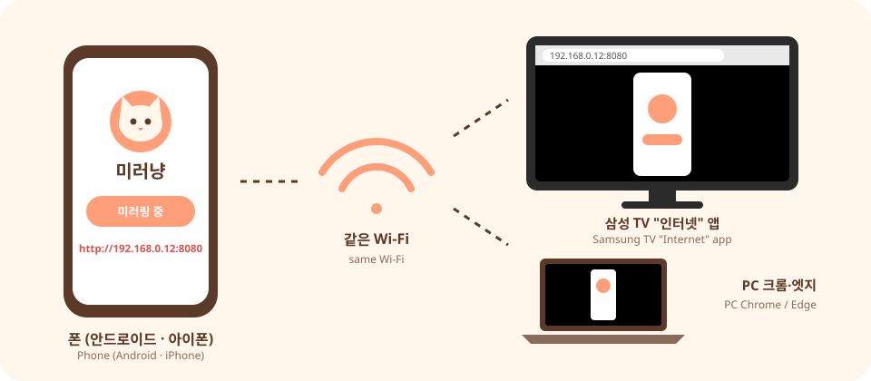
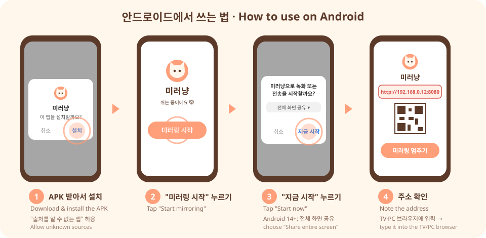
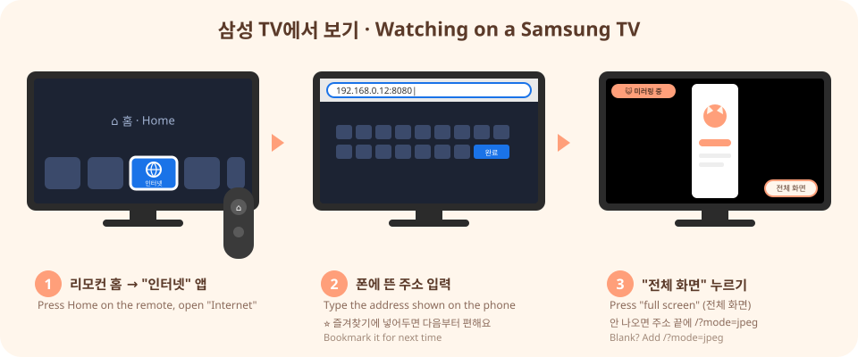
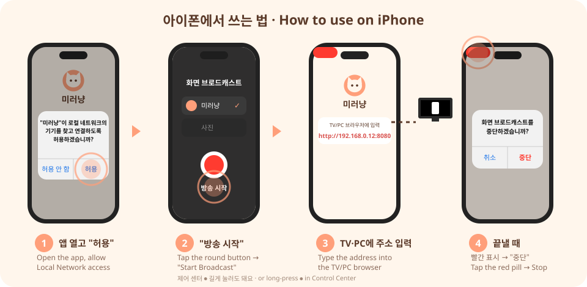
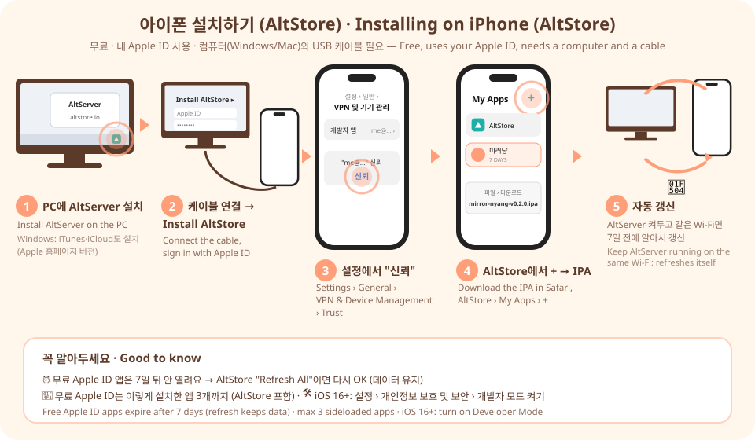

# 🐱 MirrorNyang (미러냥)

**Mirror your Android phone or iPhone screen to a smart TV or PC browser over the same Wi-Fi.**
**같은 Wi-Fi에서 안드로이드 폰이나 아이폰 화면을 스마트 TV나 PC 브라우저로 미러링하는 앱입니다.**

<p align="center"></p>

[English](#english) · [한국어](#한국어)

---

## English

MirrorNyang streams your Android phone or iPhone screen to **any browser on the same Wi-Fi**, such as a Samsung TV's built-in browser or Chrome/Edge on a PC.
Nothing needs to be installed on the TV or PC. You only type an address into the browser.

("Nyang" is the Korean sound a cat makes, like "meow". 🐾)

### 📥 Download

**[Get the latest release](https://github.com/yeomyaloo/mirror-nyang/releases/latest)**

- **Android:** Open the link on your phone, download `mirror-nyang-vX.Y.Z.apk`, and install it. You need to allow installing apps from unknown sources. Works on Android 7.0 and later.
- **iPhone:** Download `mirror-nyang-vX.Y.Z.ipa`. iPhones can't install apps straight from a link, so you install it with a free tool and your Apple ID. See [iPhone install guide](#iphone-install-guide) below. Works on iOS 15 and later.

### How to use

<p align="center"></p>

1. Open **MirrorNyang** (미러냥) on your phone and tap **미러링 시작** (Start mirroring).
2. When Android asks to share or record your screen, tap **Start now**.
   On Android 14 and later, choose "Share entire screen".
3. An address like `http://192.168.0.12:8080` appears on the phone.
4. Type that address into a browser.
   - **PC:** Use the Chrome or Edge address bar.
   - **Samsung TV:** Press Home on the remote, open the **Internet** app, and enter the address.
     Bookmark it to save time next time.

<p align="center"></p>

5. When the screen appears, press the **full screen** button (전체 화면).
6. To stop, tap **미러링 멈추기** (Stop) in the app or **Stop** in the notification.

#### Two modes

| Mode | Address | Notes |
|---|---|---|
| High quality (default) | `http://PHONE_IP:8080` | H.264 video. Smooth, with low latency (target under 0.5 s). |
| Compatibility | `http://PHONE_IP:8080/?mode=jpeg` | A stream of JPEG images (about 12 fps). Works on old TV browsers. |

If high-quality mode shows nothing for 8 seconds, the page switches to compatibility mode automatically. You can also switch with the button in the bottom-right corner.

### iPhone

#### How to use on iPhone

<p align="center"></p>

1. Open **미러냥** once. Allow **Local Network** access when asked. Without it, the TV or PC can't connect.
2. Tap the round button and choose **Start Broadcast**.
   You can also long-press the **Screen Recording** button in Control Center, choose **미러냥**, and tap **Start Broadcast**.
3. Type the address shown in the app (for example `http://192.168.0.12:8080`) into the TV or PC browser, the same as on Android.
4. To stop, tap the red indicator at the top of the screen, or use Control Center.

#### iPhone install guide

Apple doesn't let iPhones install apps from a download link the way Android does with APKs. Without the App Store, the free way is to **sign the app with your own Apple ID** using a tool on your computer. Here is what you need to know first.

| | |
|---|---|
| Cost | Free. A normal Apple ID is enough. |
| What you need | A Windows PC or Mac, and a USB cable for the first install. |
| 7-day limit | Apps signed with a free Apple ID **stop opening after 7 days**. You must refresh them (re-sign). Your data is kept. |
| 3-app limit | A free Apple ID can have **only 3 sideloaded apps** at a time. AltStore itself counts as one. |
| Trust step | After installing, you must trust your Apple ID once in Settings. |

<p align="center"></p>

**Option A: AltStore (recommended, refreshes automatically)**

1. On your computer, install **AltServer** from [altstore.io](https://altstore.io).
   On Windows, you also need **iTunes** and **iCloud** downloaded from Apple's website (not the Microsoft Store versions).
2. Connect the iPhone with a cable. In AltServer, choose **Install AltStore** and sign in with your Apple ID.
3. On the iPhone, open **Settings → General → VPN & Device Management**, tap your Apple ID, and tap **Trust**.
4. Download `mirror-nyang-vX.Y.Z.ipa` on the iPhone (Safari → save to Files).
5. Open **AltStore → My Apps → +** and pick the IPA.
6. **Auto-refresh:** Keep AltServer running on your computer. When the iPhone and computer are on the same Wi-Fi, AltStore re-signs the app in the background before the 7 days run out. If you miss it, open AltStore and tap **Refresh All** while AltServer is running.

**Option B: Sideloadly (simpler, no auto-refresh)**

1. Install **Sideloadly** from [sideloadly.io](https://sideloadly.io) on your computer (Windows or Mac).
2. Connect the iPhone with a cable, drag `mirror-nyang-vX.Y.Z.ipa` into Sideloadly, enter your Apple ID, and press **Start**.
3. On the iPhone, open **Settings → General → VPN & Device Management**, tap your Apple ID, and tap **Trust**.
4. Every 7 days, repeat step 2 to keep the app working.

> On iOS 16 and later, you may also need to turn on **Settings → Privacy & Security → Developer Mode** and restart.

**Why not TestFlight or the App Store?** Those need a paid Apple Developer account ($99/year), so they're not used for now.

### Building the APK

Requirements: JDK 17 and the Android SDK (platform `android-30`, build-tools `30.0.3`).
Point `sdk.dir` in `local.properties` to your SDK, or set `ANDROID_HOME`.

```powershell
.\gradlew.bat assembleDebug
```

The APK is written to `app\build\outputs\apk\debug\app-debug.apk`.

#### Releasing a new version

1. In `app/build.gradle`, increase `versionCode` by 1 and update `versionName`.
2. Commit, then push a tag such as `v0.2.0`.

```powershell
git tag v0.2.0
```

```powershell
git push origin main --tags
```

GitHub Actions (`.github/workflows/release.yml`) builds both apps and attaches them to the release as `mirror-nyang-v0.2.0.apk` and `mirror-nyang-v0.2.0.ipa`. For the iOS version, also update `MARKETING_VERSION` and `CURRENT_PROJECT_VERSION` in `ios/project.yml`.

The APK is signed with a public debug key kept in the repo (`app/debug.keystore`). Every build has the same signature, so users can install new versions over old ones. This key is not secret, so create a separate release key before publishing to the Play Store.

The IPA is **unsigned**. AltStore or Sideloadly signs it with the user's Apple ID during install.

### Building the iOS app (Mac)

The Xcode project is generated from `ios/project.yml` with [XcodeGen](https://github.com/yonaskolb/XcodeGen).

```bash
brew install xcodegen
```

```bash
cd ios && xcodegen generate && open MirrorNyang.xcodeproj
```

To run on your own iPhone from Xcode, pick your Apple ID team under **Signing & Capabilities** for both the `MirrorNyang` and `MirrorNyangBroadcast` targets, then press Run. With a free Apple ID you may need to change the bundle IDs (for example `com.yourname.mirrornyang` and `com.yourname.mirrornyang.broadcast`).

- `ios/MirrorNyang/`: the app screen (broadcast button and address)
- `ios/MirrorNyangBroadcast/`: the ReplayKit broadcast upload extension (H.264 with VideoToolbox, HTTP/WebSocket server with Network.framework). It reuses the receiver page from `app/src/main/assets/`.
- The broadcast extension may use only about 50 MB of memory, so video is capped at 1280 px on the long side.

### Installing on a phone

- **Without a cable:** Send the APK to your phone (messenger, Google Drive, USB), tap it, and allow installs from unknown sources. If Play Protect warns you, choose **Install anyway**. The warning appears because this is a self-built debug app.
- **With adb:** Turn on USB debugging, connect the phone, and run the command below.

```powershell
adb install -r app\build\outputs\apk\debug\app-debug.apk
```

### Troubleshooting

| Problem | Fix |
|---|---|
| The browser can't connect | Make sure both devices are on the same Wi-Fi. Turn off "AP isolation" or "guest network" on the router. |
| No address is shown | Connect the phone to Wi-Fi and start again. |
| Black screen only | Add `/?mode=jpeg` to the address to use compatibility mode. |
| Netflix or similar apps show black | Android blocks capturing DRM-protected content. This is expected. |
| The picture shrinks when the phone rotates | In this MVP, the size is fixed at the orientation you started in. Start in landscape if you want landscape. |

### How it works

- `MirrorService` runs as a `mediaProjection` foreground service.
- `H264Encoder` encodes the screen with MediaCodec (H.264 Baseline, 720p, 4 Mbps).
- `JpegCapturer` produces JPEG frames for compatibility mode (960 px, about 12 fps).
- `StreamServer` is a small HTTP + WebSocket server written from scratch, with no external libraries.
- The receiver page (`assets/index.html`) plays H.264 through MSE with [jmuxer](https://github.com/samirkumardas/jmuxer) (MIT). It is written in ES5 so old TV browsers can run it.
- Encoding starts only when the first viewer connects.
- A slow viewer drops queued frames and resumes from the next key frame, and the page jumps to the live edge when its buffer grows past 0.5 s. So latency does not build up.

> ⚠️ Anyone on the same Wi-Fi who knows the address can watch. Don't use it on public Wi-Fi. A PIN is planned.

### Roadmap

- Audio (Android 10 and later, AudioPlaybackCapture)
- Following screen rotation
- Connection PIN
- Quality and bitrate settings

---

## 한국어

같은 Wi-Fi에 있는 **삼성 TV나 PC 브라우저로 안드로이드 폰이나 아이폰 화면을 보내는** 미러링 앱입니다.
TV와 PC에는 아무것도 설치하지 않아도 되고, 브라우저에 주소만 입력하면 됩니다.

### 📥 다운로드

**[최신 버전 받기 (Releases)](https://github.com/yeomyaloo/mirror-nyang/releases/latest)**

- **안드로이드:** 폰에서 위 링크를 열고 `mirror-nyang-vX.Y.Z.apk`를 받아 설치합니다. 설치할 때 "출처를 알 수 없는 앱" 설치를 허용해야 합니다. Android 7.0 이상에서 동작합니다.
- **아이폰:** `mirror-nyang-vX.Y.Z.ipa`를 받습니다. 아이폰은 링크로 바로 설치할 수 없어서, 컴퓨터의 무료 도구와 내 Apple ID로 설치해야 합니다. 아래 [아이폰 설치 방법](#아이폰-설치-방법)을 꼭 읽어 주세요. iOS 15 이상에서 동작합니다.

### 사용법

<p align="center"></p>

1. 폰에서 **미러냥**을 열고 **미러링 시작**을 누릅니다.
2. "화면을 공유/녹화할까요?" 창이 뜨면 **지금 시작**을 누릅니다.
   Android 14 이상에서는 "전체 화면 공유"를 고르세요.
3. 폰 화면에 `http://192.168.0.12:8080` 같은 주소가 뜹니다.
4. 그 주소를 브라우저에 입력합니다.
   - **PC:** 크롬이나 엣지 주소창에 입력합니다.
   - **삼성 TV:** 리모컨 홈 → **인터넷** 앱 → 주소창에 입력합니다.
     한 번 연 다음 즐겨찾기에 넣어두면 다음부터 편합니다.

<p align="center"></p>

5. 화면이 나오면 **전체 화면** 버튼을 누릅니다. 리모컨으로 버튼을 선택하고 확인을 누르면 됩니다.
6. 끝낼 때는 앱의 **미러링 멈추기** 버튼이나 알림의 **멈추기** 버튼을 누릅니다.

#### 두 가지 모드
| 모드 | 주소 | 특징 |
|---|---|---|
| 고화질 (기본) | `http://폰IP:8080` | H.264 영상입니다. 부드럽고 지연이 적습니다(목표 0.5초 이하). |
| 호환 | `http://폰IP:8080/?mode=jpeg` | JPEG 사진을 연속으로 보냅니다(약 12fps). 오래된 TV 브라우저에서도 잘 됩니다. |

고화질 모드로 8초 동안 화면이 안 나오면 호환 모드로 자동으로 바뀝니다. 화면 오른쪽 아래 버튼으로 직접 바꿀 수도 있습니다.

### 아이폰

#### 아이폰에서 쓰는 법

<p align="center"></p>

1. **미러냥** 앱을 한 번 엽니다. **로컬 네트워크** 권한을 물어보면 **허용**을 누릅니다. 허용하지 않으면 TV나 PC가 접속할 수 없습니다.
2. 동그라미 버튼을 누르고 **방송 시작**을 누릅니다.
   제어 센터의 **화면 기록** 버튼을 길게 누르고 **미러냥**을 고른 뒤 **방송 시작**을 눌러도 됩니다.
3. 앱에 보이는 주소(예: `http://192.168.0.12:8080`)를 TV나 PC 브라우저에 입력합니다. 안드로이드와 똑같습니다.
4. 끝낼 때는 화면 위쪽의 빨간 표시를 누르거나 제어 센터에서 방송을 멈춥니다.

#### 아이폰 설치 방법

아이폰은 안드로이드의 APK처럼 링크를 눌러 앱을 설치할 수 없습니다. App Store 없이 무료로 설치하려면, 컴퓨터의 도구로 **내 Apple ID로 앱에 서명해서** 설치해야 합니다. 시작하기 전에 아래 내용을 꼭 알아두세요.

| | |
|---|---|
| 비용 | 무료입니다. 평소 쓰는 Apple ID면 됩니다. |
| 필요한 것 | Windows PC나 Mac, 처음 설치할 때 쓸 USB 케이블 |
| 7일 제한 | 무료 Apple ID로 설치한 앱은 **7일이 지나면 열리지 않습니다.** 그 전에 갱신(다시 서명)해야 합니다. 앱 데이터는 지워지지 않습니다. |
| 3개 제한 | 무료 Apple ID로는 이렇게 설치한 앱을 **동시에 3개까지만** 쓸 수 있습니다. AltStore도 1개로 칩니다. |
| 개발자 신뢰 | 설치한 뒤 설정에서 내 Apple ID를 한 번 "신뢰"해야 합니다. |

<p align="center"></p>

**방법 A: AltStore (추천, 자동 갱신)**

1. 컴퓨터에 [altstore.io](https://altstore.io)에서 **AltServer**를 설치합니다.
   Windows에서는 **iTunes**와 **iCloud**도 설치해야 합니다. Microsoft Store 버전이 아니라 Apple 홈페이지에서 받은 버전이어야 합니다.
2. 아이폰을 케이블로 연결하고, AltServer에서 **Install AltStore**를 누른 뒤 Apple ID로 로그인합니다.
3. 아이폰에서 **설정 → 일반 → VPN 및 기기 관리**에 들어가 내 Apple ID를 누르고 **신뢰**를 누릅니다.
4. 아이폰 Safari에서 `mirror-nyang-vX.Y.Z.ipa`를 받아 "파일" 앱에 저장합니다.
5. **AltStore → My Apps → +**를 누르고 받은 IPA를 고릅니다.
6. **자동 갱신:** 컴퓨터에 AltServer를 켜두세요. 아이폰과 컴퓨터가 같은 Wi-Fi에 있으면 7일이 지나기 전에 AltStore가 백그라운드에서 다시 서명해 줍니다. 7일 안에 한 번은 컴퓨터가 켜져 있어야 합니다. 놓쳤다면 AltServer를 켠 상태에서 AltStore의 **Refresh All**을 누르면 됩니다.

**방법 B: Sideloadly (더 간단, 자동 갱신 없음)**

1. 컴퓨터(Windows나 Mac)에 [sideloadly.io](https://sideloadly.io)에서 **Sideloadly**를 설치합니다.
2. 아이폰을 케이블로 연결하고, `mirror-nyang-vX.Y.Z.ipa`를 Sideloadly 창에 끌어다 놓은 뒤 Apple ID를 입력하고 **Start**를 누릅니다.
3. 아이폰에서 **설정 → 일반 → VPN 및 기기 관리**에 들어가 내 Apple ID를 누르고 **신뢰**를 누릅니다.
4. 7일마다 2번을 다시 해야 앱이 계속 열립니다.

> iOS 16 이상에서는 **설정 → 개인정보 보호 및 보안 → 개발자 모드**를 켜고 재시동해야 할 수도 있습니다.

**왜 TestFlight나 App Store가 아닌가요?** 둘 다 유료 Apple 개발자 계정(연 $99)이 필요해서 지금은 쓰지 않습니다.

### APK 빌드 (Windows)

이 PC에 이미 있는 도구만 씁니다. 새로 설치할 것은 없습니다.

| 도구 | 버전 | 위치 |
|---|---|---|
| JDK | 17 | `C:\Program Files\Java\jdk-17` |
| Gradle | 7.6.3 | `C:\Program Files\gradle-7.6.3` (PATH에 등록됨) |
| Android SDK | platform android-30, build-tools 30.0.3 | `%LOCALAPPDATA%\Android\Sdk` |

`local.properties`의 `sdk.dir`가 위 SDK 경로를 가리킵니다. 이 파일은 git에 올리지 않습니다.
다른 PC에서 빌드하려면 그 PC의 SDK 경로로 고쳐야 합니다.

```powershell
cd $env:USERPROFILE\Documents\GitHub\mirror-nyang
```

```powershell
gradle assembleDebug
```

Gradle이 설치되어 있지 않은 PC에서는 `.\gradlew.bat assembleDebug`를 실행하면 됩니다. 처음 한 번 Gradle 7.6.3을 자동으로 받습니다.

빌드가 끝나면 APK가 `app\build\outputs\apk\debug\app-debug.apk`에 생깁니다.

첫 빌드는 Gradle이 Android Gradle Plugin과 Kotlin 같은 라이브러리를 받아 `~/.gradle` 캐시에 저장하느라 몇 분 걸립니다.

#### 새 버전 배포 (GitHub Releases)

1. `app/build.gradle`의 `versionCode`를 1 올리고, `versionName`도 새 버전으로 바꿉니다.
2. 커밋한 뒤 태그를 붙여 push합니다.

```powershell
git tag v0.2.0
```

```powershell
git push origin main --tags
```

태그가 올라가면 GitHub Actions(`.github/workflows/release.yml`)가 두 앱을 빌드해서 Release에 `mirror-nyang-v0.2.0.apk`와 `mirror-nyang-v0.2.0.ipa`로 첨부합니다. 아이폰판 버전은 `ios/project.yml`의 `MARKETING_VERSION`과 `CURRENT_PROJECT_VERSION`도 같이 올리세요.

IPA는 **서명하지 않은 상태**로 올라갑니다. 사용자가 설치할 때 AltStore나 Sideloadly가 그 사람의 Apple ID로 서명합니다.

### 아이폰 앱 빌드 (Mac)

Xcode 프로젝트는 [XcodeGen](https://github.com/yonaskolb/XcodeGen)으로 `ios/project.yml`에서 만듭니다.

```bash
brew install xcodegen
```

```bash
cd ios && xcodegen generate && open MirrorNyang.xcodeproj
```

Xcode에서 내 아이폰으로 바로 실행하려면 `MirrorNyang`과 `MirrorNyangBroadcast` 두 타깃 모두 **Signing & Capabilities**에서 내 Apple ID 팀을 고르고 Run을 누릅니다. 무료 Apple ID에서는 번들 ID를 바꿔야 할 수도 있습니다(예: `com.yourname.mirrornyang`, `com.yourname.mirrornyang.broadcast`).

- `ios/MirrorNyang/`: 앱 화면(방송 버튼, 접속 주소)
- `ios/MirrorNyangBroadcast/`: ReplayKit 방송 확장입니다. VideoToolbox로 H.264를 만들고, Network.framework로 HTTP/WebSocket 서버를 돌립니다. 수신 페이지는 `app/src/main/assets/`의 것을 같이 씁니다.
- 방송 확장은 메모리를 약 50MB까지만 쓸 수 있어서 영상 긴 변을 1280px로 제한했습니다.

APK는 저장소에 들어 있는 공개 디버그 키(`app/debug.keystore`)로 서명합니다. 그래서 누가 빌드해도 서명이 같고, 사용자는 새 버전을 덮어 설치할 수 있습니다. 비밀 키가 아니므로 Play 스토어에 올릴 때는 별도의 릴리스 키를 만들어야 합니다.

### 폰에 설치

**방법 A: 파일로 옮기기 (케이블이나 adb 없이)**
1. `app-debug.apk`를 카카오톡 "나와의 채팅", 구글 드라이브, USB 등으로 폰에 옮깁니다.
2. 폰에서 파일을 누르고, "출처를 알 수 없는 앱 설치"를 허용한 뒤 설치합니다.
3. 플레이 프로텍트 경고가 뜨면 **무시하고 설치**를 누릅니다. 직접 만든 디버그 앱이라 뜨는 경고입니다.

**방법 B: adb로 설치**
폰에서 개발자 옵션과 USB 디버깅을 켜고 USB로 연결한 뒤 실행합니다. adb는 SDK의 platform-tools 폴더에 있습니다.

```powershell
& "$env:LOCALAPPDATA\Android\Sdk\platform-tools\adb.exe" install -r app\build\outputs\apk\debug\app-debug.apk
```

### 테스트 체크리스트

- [ ] 폰과 PC/TV가 **같은 Wi-Fi**에 연결되어 있습니다. 게스트 Wi-Fi는 기기끼리 통신을 막는 경우가 많습니다.
- [ ] 앱에서 시작을 누르면 주소와 QR 코드가 뜹니다.
- [ ] PC 크롬에서 주소를 열면 1~2초 안에 화면이 나옵니다.
- [ ] 폰에서 스크롤해보면 PC 화면이 0.5초 정도 안에 따라옵니다.
- [ ] 삼성 TV 인터넷 앱에서 같은 주소가 열립니다. 안 되면 `/?mode=jpeg`로 엽니다.
- [ ] PC와 TV에서 동시에 열어도 둘 다 나옵니다.
- [ ] 알림의 **멈추기**를 누르면 수신 화면에 "연결이 끊겼어요"가 뜹니다.

문제가 생기면 로그를 봅니다. adb를 쓸 때만 가능합니다.

```powershell
& "$env:LOCALAPPDATA\Android\Sdk\platform-tools\adb.exe" logcat -s MirrorNyang MirrorNyang/Server MirrorNyang/H264
```

### 문제 해결

| 증상 | 해결 |
|---|---|
| 브라우저에서 접속이 안 됨 | 같은 Wi-Fi인지 확인하세요. 공유기의 "AP 격리"나 "게스트 네트워크" 기능을 끄세요. 주소의 IP가 폰의 Wi-Fi IP인지도 확인하세요. |
| 주소가 안 뜸 / "Wi-Fi 주소를 찾지 못했어요" | 폰을 Wi-Fi에 연결한 뒤 다시 시작하세요. |
| 검은 화면만 나옴 | 주소 끝에 `/?mode=jpeg`를 붙여 호환 모드로 열어보세요. |
| 넷플릭스 같은 앱 화면이 검게 나옴 | 저작권 보호(DRM) 화면은 안드로이드가 캡처를 막습니다. 정상 동작입니다. |
| 폰을 가로로 돌리면 화면이 작아짐 | MVP에서는 시작할 때의 방향으로 크기가 고정됩니다. 가로로 쓰려면 폰을 가로로 둔 상태에서 시작하세요. |

### 구조

```
app/src/main/
├── java/com/mirrornyang/app/
│   ├── MainActivity.kt    # 시작/정지 버튼, 접속 주소 + QR 표시
│   ├── MirrorService.kt   # 포그라운드 서비스: MediaProjection, 알림, 파이프라인 관리
│   ├── H264Encoder.kt     # VirtualDisplay → MediaCodec(H.264, Baseline, 720p, 4Mbps)
│   ├── JpegCapturer.kt    # 호환 모드: ImageReader → JPEG (960px, 약 12fps)
│   ├── StreamServer.kt    # 직접 구현한 HTTP + WebSocket 서버 (외부 라이브러리 없음)
│   └── NetUtil.kt         # 폰의 사설망 IPv4 주소 찾기
└── assets/
    ├── index.html         # 수신 페이지 (구형 TV 브라우저도 돌도록 ES5로 작성)
    └── jmuxer.min.js      # H.264 → MSE 재생 라이브러리 (jmuxer 2.0.7, MIT)
```

- 미러링 영상은 수신기가 처음 접속할 때부터 만들기 시작합니다. 아무도 보지 않으면 인코딩하지 않습니다.
- 네트워크가 느린 수신기는 쌓인 프레임을 버리고 다음 키프레임부터 다시 받습니다. 그래서 지연이 계속 쌓이지 않습니다.
- 수신 페이지는 버퍼가 0.5초 넘게 쌓이면 맨 끝으로 건너뜁니다.

### 설계 결정 메모

- **수신은 브라우저로 합니다.** 삼성 TV나 PC에 따로 앱을 깔 필요가 없습니다.
  - Miracast는 서드파티 앱에 API가 없어서 쓸 수 없습니다.
  - DLNA는 버퍼링 때문에 지연이 수 초라 미러링에 맞지 않습니다.
  - Google Cast는 삼성 TV에서 지원하지 않습니다.
- **WebCodecs 대신 MSE(jmuxer)를 씁니다.** WebCodecs는 HTTPS나 localhost 같은 보안 컨텍스트에서만 동작하는데, `http://192.168.x.x`는 보안 컨텍스트가 아닙니다.
- **기기는 주소를 화면에 표시해서 연결합니다.** 브라우저는 mDNS 탐색을 할 수 없기 때문입니다. 카메라가 있는 기기를 위해 QR 코드도 같이 보여줍니다.
- **compileSdk/targetSdk는 30입니다.** 이 PC에 설치된 SDK에 맞춘 값입니다. APK로 직접 배포하므로 Play 스토어의 targetSdk 요구사항과는 상관없습니다.

### 다음 단계 아이디어

- 소리 전송 (Android 10 이상, AudioPlaybackCapture)
- 화면 회전 따라가기
- 접속 PIN: 지금은 같은 Wi-Fi에 있는 누구나 주소를 알면 볼 수 있습니다. 공용 Wi-Fi에서는 쓰지 마세요.
- 화질과 비트레이트 설정 화면
