# 📱 MirrorNyang Android Guide

[한국어](guide-android.ko.md) · [Back to README](../README.md) · [🍎 iPhone guide](guide-iphone.en.md)

This guide shows, step by step with pictures, how to show your Android phone screen on a **Samsung TV or a PC browser**.
The first install takes about 5 minutes. After that it's just **open the app → start → type the address on the TV**.

> The app's screens are in Korean. Each step below gives the Korean label you'll see, with its English meaning.

## What you need

| | |
|---|---|
| Android phone | Android 7.0 or later |
| Receiver | A Samsung TV (built-in "Internet" app) or a PC (Chrome/Edge) |
| **Same Wi-Fi** | The phone and the TV/PC must be on the **same router**. Different names for 2.4 GHz and 5 GHz on the same router are usually fine. |

> ⚠️ Café, office, and school Wi-Fi, or "guest networks", often block devices from talking to each other, so it may not work there.

## Contents

- [Part 1. Install (first time only)](#part-1-install-first-time-only)
- [Part 2. Start mirroring](#part-2-start-mirroring)
- [Part 3. Watch on the TV or PC](#part-3-watch-on-the-tv-or-pc)
- [Part 4. Stop](#part-4-stop)
- [Troubleshooting](#troubleshooting)

---

## Part 1. Install (first time only)

### Step 1. Download the APK from Releases

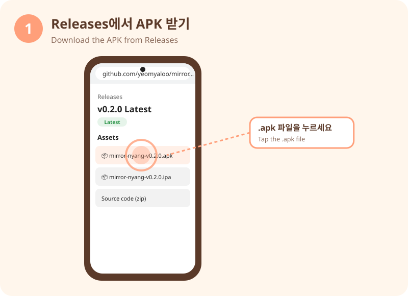

1. **On your phone**, open the [Releases page](https://github.com/yeomyaloo/mirror-nyang/releases/latest).
2. Under **Assets**, tap the file **ending in `.apk`**, such as `mirror-nyang-v0.2.0.apk`.

- If Assets is collapsed, tap "Assets" to expand it.
- The `.ipa` file is for iPhones and doesn't work on Android.
- If you downloaded it on a PC, you can send it to your phone with a messenger app or Google Drive.

### Step 2. If you see a warning, tap "Download"

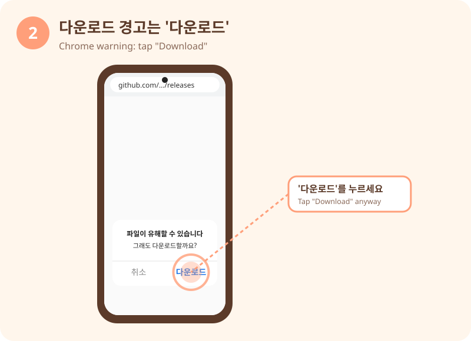

Chrome warns that **"this file might be harmful"** for every APK downloaded outside the Play Store.
MirrorNyang's full source code is public on GitHub, so tap **Download** (다운로드).

When the download finishes, tap **Open** at the bottom of the screen or in the notification to start installing.
If you missed it, open **My Files → Downloads** and tap the APK.

### Step 3. Turn on "Allow from this source"

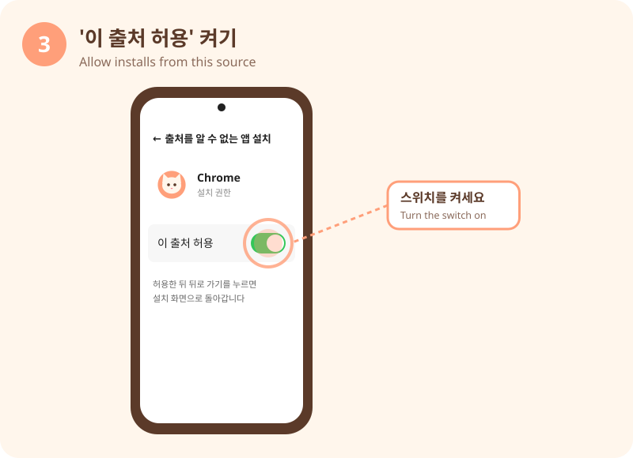

The first time you install an APK, Android may say it **can't install unknown apps from this source**.

1. Tap **Settings** in the message.
2. Turn on **Allow from this source** (이 출처 허용).
3. Press **Back** to return to the installer.

- You only need to do this once.
- To find it yourself on a Samsung phone: **Settings → Apps → (⋮) Special access → Install unknown apps → Chrome (or My Files) → Allow**.
- You can turn it off again after installing. MirrorNyang keeps working.

### Step 4. Tap "Install"

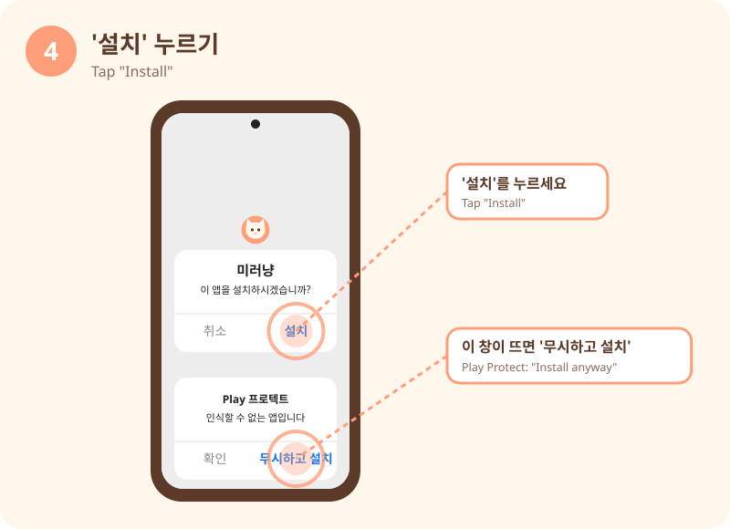

1. On **"Do you want to install this app?"**, tap **Install** (설치).
2. If **Play Protect** appears, tap **Install anyway** (무시하고 설치), or "More details → Install anyway".
   - This appears because Google doesn't know this self-built app yet.
   - If it asks whether to send the app for scanning, either choice is fine.
3. When it finishes, tap **Open**. A 🐱 **미러냥** icon also appears on your home screen.

---

## Part 2. Start mirroring

### Step 5. Open the app and tap "Start mirroring"

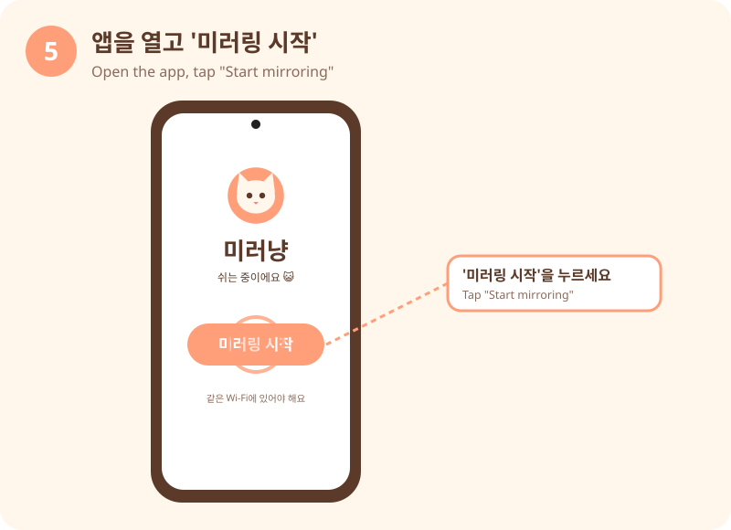

Open MirrorNyang and tap the big **미러링 시작** (Start mirroring) button.

- On Android 13 and later, if it asks to **allow notifications**, tap **Allow**. The notification shows a **Stop** button and how many devices are watching.

### Step 6. Tap "Start now"

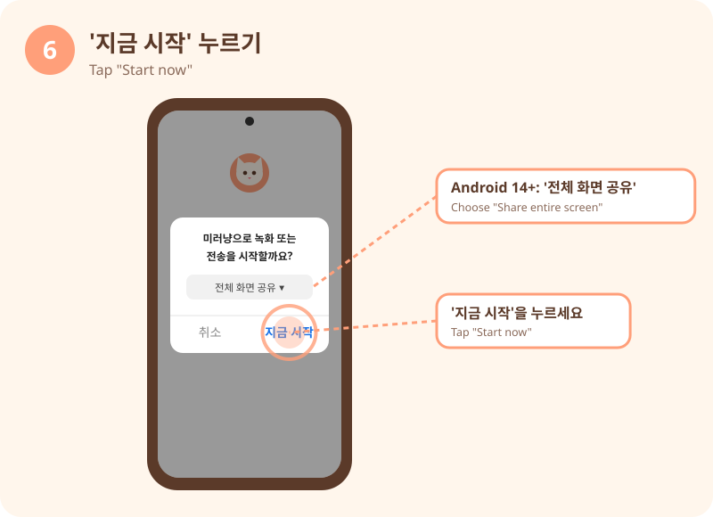

Android asks whether to **start recording or casting with 미러냥**. Tap **Start now** (지금 시작).

- On **Android 14 and later**, choose **Share entire screen** at the top. If you pick "Share one app", only that app is shown.
- This prompt appears every time you start. It's an Android security rule and can't be skipped.

### Step 7. Note the address on the screen

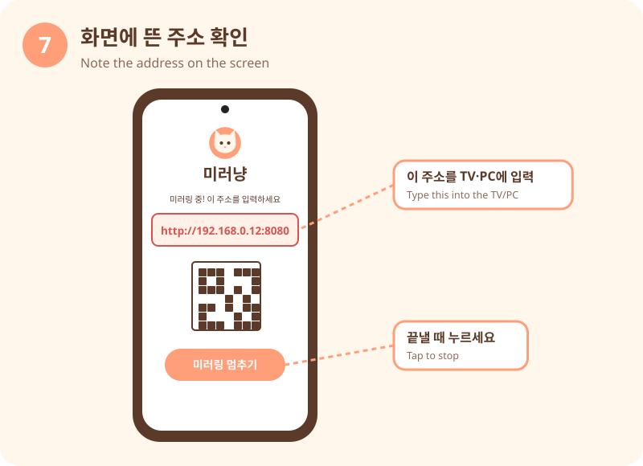

A red address like **`http://192.168.0.12:8080`** appears. Type it into the TV or PC browser (Part 3).

- The numbers differ for every home. Type **the address shown on your phone**.
- If there are several lines, use the **first one** (Wi-Fi).
- On a device with a camera, you can scan the QR code instead.
- If it says it **couldn't find a Wi-Fi address**, connect the phone to Wi-Fi and start again.
- Mirroring keeps running when you leave the app. But **if the phone screen turns off, the TV picture freezes too.**

---

## Part 3. Watch on the TV or PC

### Samsung TV 1. Home → "Internet" app

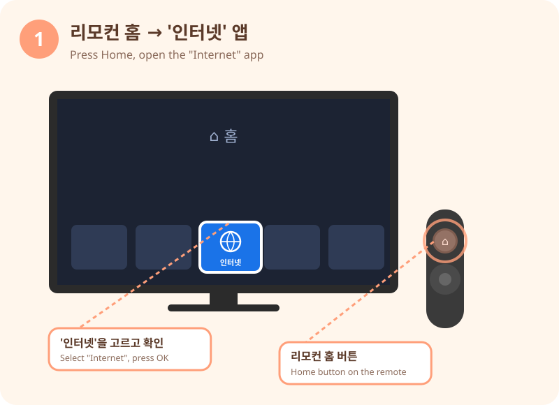

1. Press **Home (⌂)** on the remote.
2. Select **Internet** (globe icon) in the bottom menu and press OK.

- If it's not there, look in the **Apps** list or search for "Internet".

### Samsung TV 2. Type the address shown on the phone

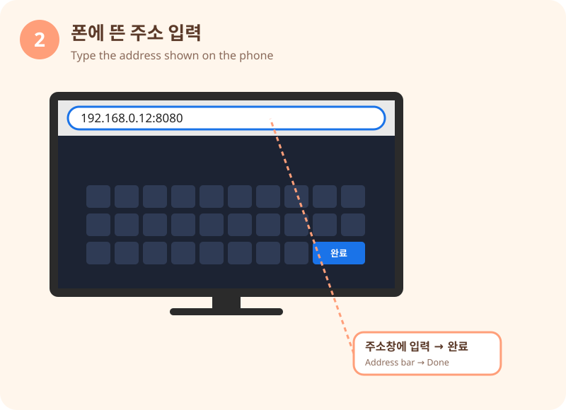

1. Select the **address bar** at the top and press OK to open the on-screen keyboard.
2. Type the address shown on your phone and press **Done**. Example: `192.168.0.12:8080`

- You can leave out `http://`.
- Don't forget the **colon (`:`)** and the **`8080`** at the end.
- After opening it once, add it to **Bookmarks (☆)**. The address usually stays the same unless your router changes it.

### Samsung TV 3. When the phone screen appears, go full screen

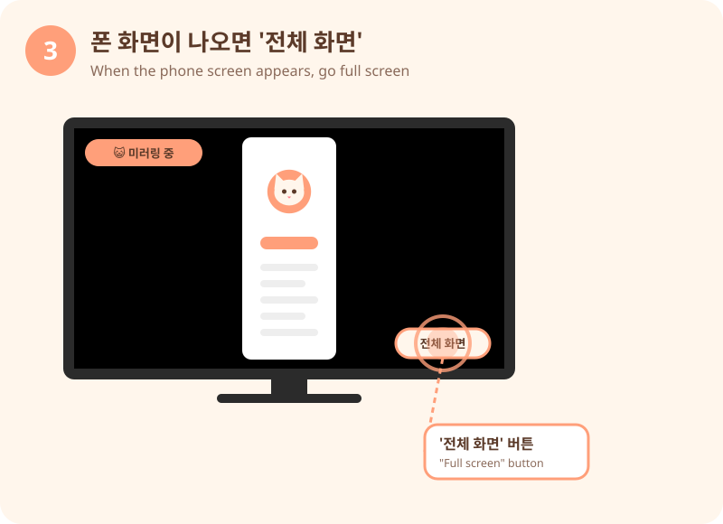

After 1–2 seconds the phone screen appears with **😺 미러링 중** (Mirroring) at the top left.
Use the arrow keys to move to the **전체 화면** (Full screen) button at the bottom right and press OK.

- The buttons hide after 3 seconds. Press any key on the remote to bring them back.
- The delay between the phone and the TV is usually about 0.5 seconds.

### Samsung TV 4. Not working? Use compatibility mode

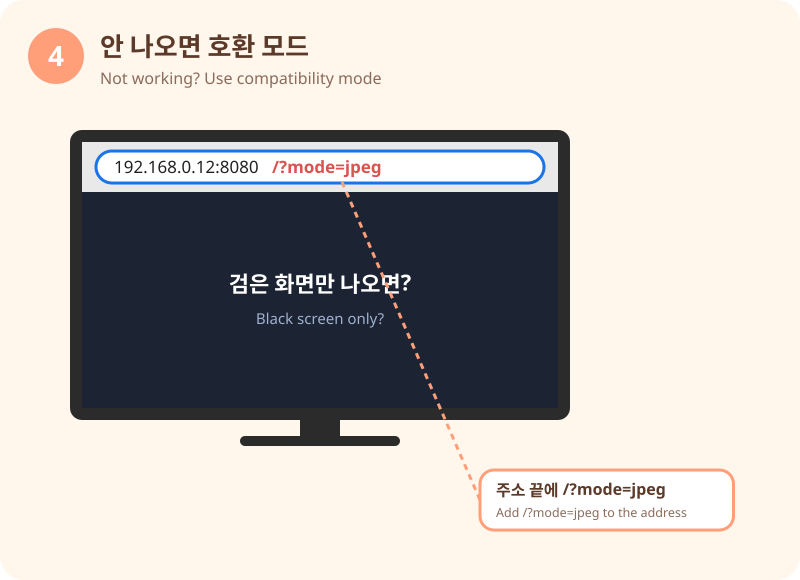

If it connects but shows **only a black screen**, add **`/?mode=jpeg`** to the end of the address and open it again.
Example: `192.168.0.12:8080/?mode=jpeg`

- Compatibility mode sends a fast series of pictures (about 12 per second) instead of video. It's a little less smooth but works on older TVs.
- If high-quality mode shows nothing for 8 seconds, the page switches to compatibility mode automatically.

### Watching on a PC

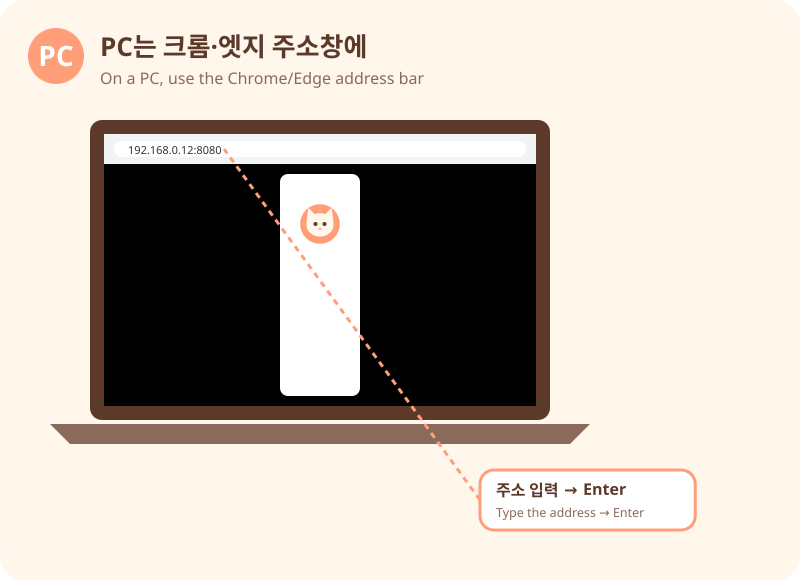

Type the address shown on your phone into the **Chrome** or **Edge** address bar and press Enter.
Double-click the picture or press the **전체 화면** (Full screen) button to fill the screen.

- You can watch on the TV and the PC **at the same time**.

---

## Part 4. Stop

Do either of these to stop. The TV shows a "disconnected" message.

- Tap **미러링 멈추기** (Stop mirroring) in the app.
- Open the MirrorNyang notification and tap **Stop** (멈추기).

---

## Troubleshooting

| Problem | What to do |
|---|---|
| The TV/PC can't connect | ① Make sure the phone and TV/PC are on the **same Wi-Fi**. ② Guest networks and office/school Wi-Fi often block device-to-device traffic. ③ Turn off **"AP isolation"** in your router settings. ④ Check the numbers, the colon (`:`), and `8080` again. |
| No address is shown | Connect the phone to Wi-Fi, then stop and start again. |
| It connects but the screen is black | Add `/?mode=jpeg` to the address (compatibility mode). Also check that the phone screen is on. |
| Only Netflix, Disney+, etc. show black | Android blocks capturing DRM-protected video. This is expected and can't be fixed. |
| There's no sound | This version sends the picture only. Sound is planned. |
| It stutters or lags | Move the phone and TV closer to the router. 5 GHz Wi-Fi works better. |
| The picture shrinks when I rotate the phone | This version keeps the orientation you started in. Start with the phone in landscape if you want landscape. |
| Can other people watch? | Anyone on the same Wi-Fi who knows the address can. Don't use it on public Wi-Fi. |

Still stuck? Open a [GitHub issue](https://github.com/yeomyaloo/mirror-nyang/issues) with your phone model, Android version, TV model, and what happens.
