# 📱 미러냥 안드로이드 설명서

[English](guide-android.en.md) · [README로 돌아가기](../README.md) · [🍎 아이폰 설명서](guide-iphone.ko.md)

안드로이드 폰 화면을 **삼성 TV나 PC 브라우저**에 띄우는 방법을 처음부터 끝까지 그림으로 설명합니다.
처음 설치까지 5분쯤 걸리고, 그다음부터는 **앱 열기 → 시작 → TV에 주소 입력** 세 번이면 됩니다.

## 준비물

| 필요한 것 | 설명 |
|---|---|
| 안드로이드 폰 | Android 7.0 이상 |
| 받는 쪽 | 삼성 TV(내장 "인터넷" 앱) 또는 PC(크롬·엣지) |
| **같은 Wi-Fi** | 폰과 TV/PC가 **같은 공유기**에 연결되어 있어야 합니다. 2.4GHz와 5GHz처럼 이름이 달라도, 같은 공유기면 대부분 괜찮습니다. |

> ⚠️ 카페·회사·학교 Wi-Fi나 "게스트 네트워크"는 기기끼리 통신을 막아둔 경우가 많아서 연결이 안 될 수 있습니다.

## 목차

- [1부. 설치하기 (처음 한 번만)](#1부-설치하기-처음-한-번만)
- [2부. 미러링 시작하기](#2부-미러링-시작하기)
- [3부. TV·PC에서 보기](#3부-tvpc에서-보기)
- [4부. 끝내기](#4부-끝내기)
- [문제 해결](#문제-해결)

---

## 1부. 설치하기 (처음 한 번만)

### 1단계. Releases에서 APK 받기

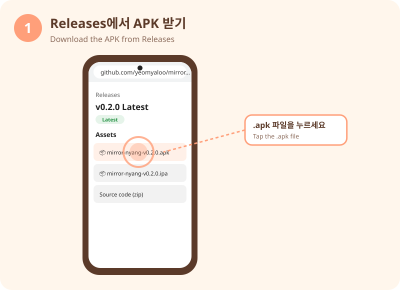

1. **폰에서** [Releases 페이지](https://github.com/yeomyaloo/mirror-nyang/releases/latest)를 엽니다.
2. 아래쪽 **Assets**에서 `mirror-nyang-v0.2.0.apk`처럼 **`.apk`로 끝나는 파일**을 누릅니다.

- Assets가 접혀 있으면 "Assets"를 눌러 펼치세요.
- `.ipa`는 아이폰용 파일이라 안드로이드에서는 쓸 수 없습니다.
- PC에서 받았다면 카카오톡 "나와의 채팅"이나 구글 드라이브로 폰에 보내도 됩니다.

### 2단계. 다운로드 경고가 뜨면 "다운로드"

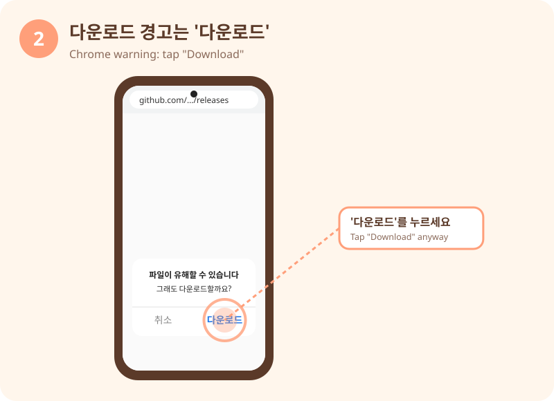

크롬은 Play 스토어 밖에서 받는 APK 파일마다 **"파일이 유해할 수 있습니다"** 경고를 띄웁니다.
미러냥은 GitHub에 소스 코드가 모두 공개된 앱이니 **다운로드**를 누르세요.

다운로드가 끝나면 화면 아래나 알림에 **열기**가 나옵니다. 그걸 누르면 바로 설치로 넘어갑니다.
놓쳤다면 **내 파일 → 다운로드**에서 APK를 누르세요.

### 3단계. "이 출처 허용" 켜기

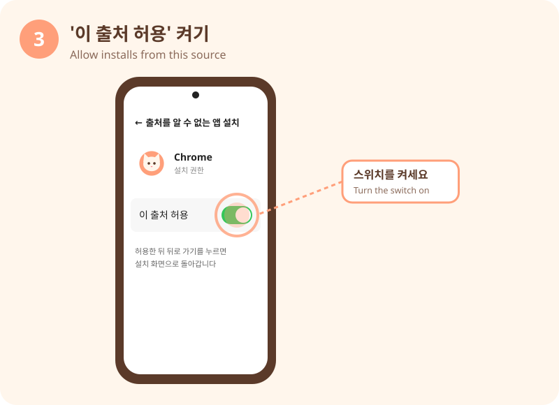

처음 APK를 설치하면 **"보안상의 이유로 이 출처의 알 수 없는 앱을 설치할 수 없습니다"**가 뜰 수 있습니다.

1. 창에서 **설정**을 누릅니다.
2. **이 출처 허용** 스위치를 켭니다.
3. **뒤로 가기**를 누르면 설치 화면으로 돌아갑니다.

- 이 설정은 처음 한 번만 하면 됩니다.
- 삼성 폰에서 직접 찾으려면: **설정 → 애플리케이션 → (⋮) 특별한 접근 → 출처를 알 수 없는 앱 설치 → Chrome(또는 내 파일) → 허용**
- 설치가 끝난 뒤 다시 꺼도 미러냥은 계속 쓸 수 있습니다.

### 4단계. "설치" 누르기

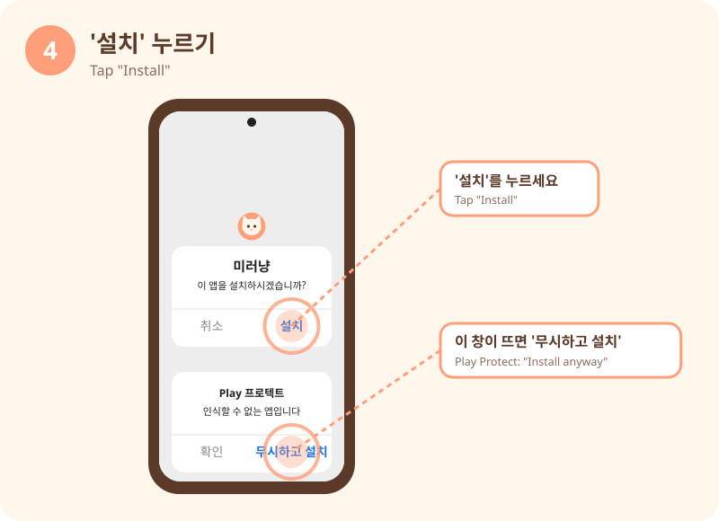

1. **"이 앱을 설치하시겠습니까?"**에서 **설치**를 누릅니다.
2. **Play 프로텍트** 창이 뜨면 **무시하고 설치**(또는 "세부정보 더보기 → 무시하고 설치")를 누릅니다.
   - 직접 만든 앱이라 Google이 아직 모르는 앱이어서 뜨는 경고입니다.
   - "앱 검사를 위해 보내시겠습니까?"가 나오면 어느 쪽을 골라도 괜찮습니다.
3. 설치가 끝나면 **열기**를 누릅니다. 홈 화면에도 🐱 **미러냥** 아이콘이 생깁니다.

---

## 2부. 미러링 시작하기

### 5단계. 앱을 열고 "미러링 시작"

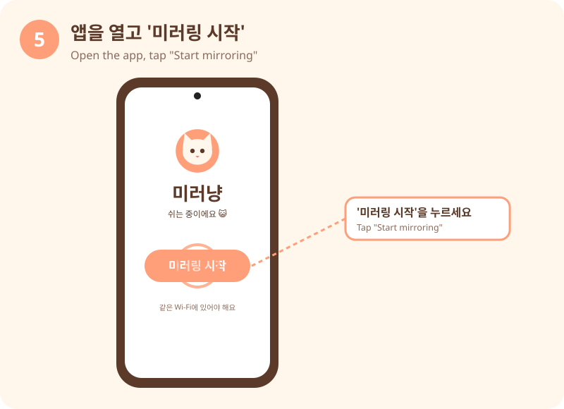

미러냥을 열고 가운데 **미러링 시작** 버튼을 누릅니다.

- Android 13 이상에서 **알림 허용**을 물어보면 **허용**을 누르세요. 알림에 **멈추기** 버튼과 보고 있는 기기 수가 표시됩니다.

### 6단계. "지금 시작" 누르기

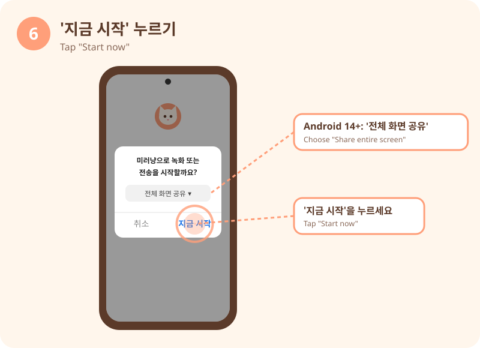

안드로이드가 **"미러냥으로 녹화 또는 전송을 시작할까요?"**라고 확인합니다. **지금 시작**을 누르세요.

- **Android 14 이상**에서는 위쪽에서 **전체 화면 공유**를 골라야 합니다. "앱 한 개 공유"를 고르면 그 앱 화면만 보입니다.
- 이 확인 창은 미러링을 시작할 때마다 나옵니다. 안드로이드 보안 정책이라 건너뛸 수 없어요.

### 7단계. 화면에 뜬 주소 확인

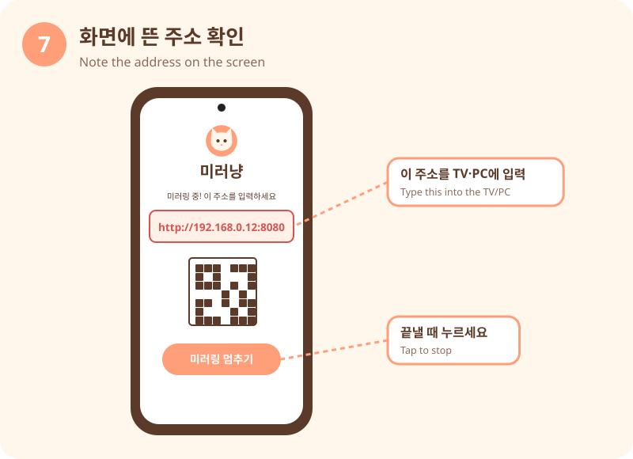

**`http://192.168.0.12:8080`** 같은 빨간 주소가 뜹니다. 이 주소를 TV나 PC 브라우저에 입력하면 됩니다(3부).

- 숫자는 집마다 다릅니다. **내 폰에 뜬 주소**를 그대로 입력하세요.
- 주소가 여러 줄이면 **첫 번째 주소**(Wi-Fi)를 쓰세요.
- 카메라가 있는 기기라면 QR 코드를 찍어서 열어도 됩니다.
- **"Wi-Fi 주소를 찾지 못했어요"**가 뜨면 폰을 Wi-Fi에 연결하고 다시 시작하세요.
- 앱을 나가서 다른 앱을 써도 미러링은 계속됩니다. 단, **폰 화면이 꺼지면 TV 화면도 멈춥니다.**

---

## 3부. TV·PC에서 보기

### 삼성 TV 1. 리모컨 홈 → "인터넷" 앱

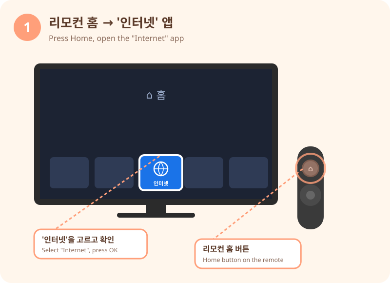

1. 리모컨의 **홈(⌂)** 버튼을 누릅니다.
2. 아래 메뉴에서 **인터넷**(지구본 아이콘)을 골라 확인을 누릅니다.

- 메뉴에 없으면 **앱** 목록에서 찾거나, 검색에서 "인터넷"을 입력하세요.

### 삼성 TV 2. 폰에 뜬 주소 입력

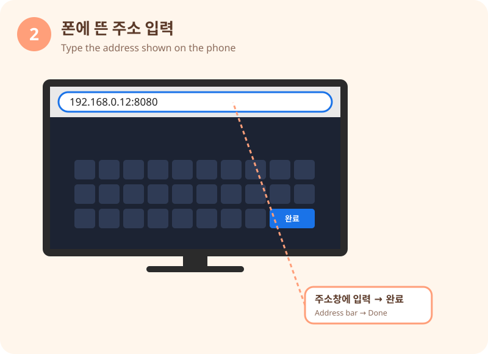

1. 위쪽 **주소창**을 고르고 확인을 누르면 화면 키보드가 나옵니다.
2. 폰에 뜬 주소를 입력하고 **완료**를 누릅니다. 예: `192.168.0.12:8080`

- 앞의 `http://`는 빼도 됩니다.
- 가운데 **콜론(`:`)**과 끝의 **`8080`**까지 꼭 넣어야 합니다.
- 한 번 연 뒤 **즐겨찾기(☆)**에 추가해 두면 다음부터 고르기만 하면 됩니다. 주소는 공유기가 바꾸지 않는 한 대부분 그대로입니다.

### 삼성 TV 3. 폰 화면이 나오면 "전체 화면"

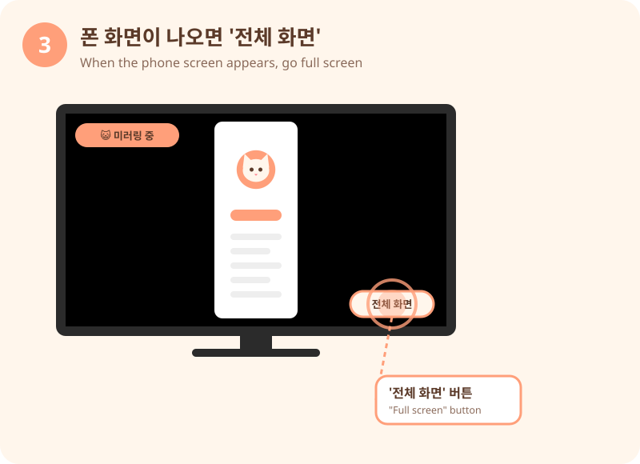

1~2초 뒤 폰 화면이 나오고 왼쪽 위에 **😺 미러링 중**이 표시됩니다.
리모컨 방향키로 오른쪽 아래 **전체 화면** 버튼으로 이동해 확인을 누르세요.

- 버튼과 표시는 3초 뒤 사라집니다. 리모컨을 움직이면 다시 나옵니다.
- 지연(폰 화면과 TV 화면의 시간 차이)은 보통 0.5초 안팎입니다.

### 삼성 TV 4. 안 나오면 호환 모드

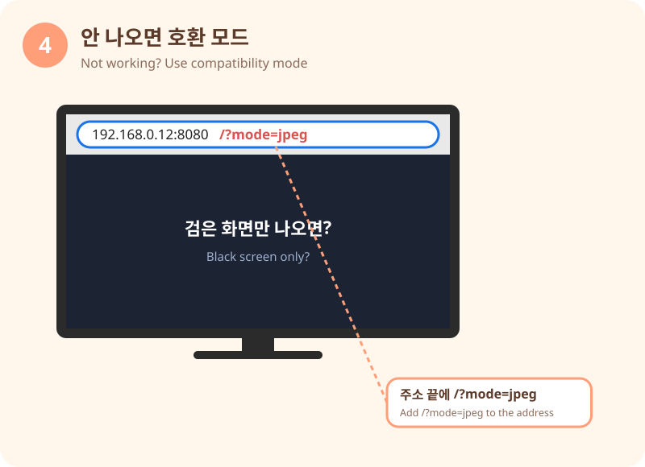

연결은 됐는데 **검은 화면만 나오면**, 주소 끝에 **`/?mode=jpeg`**를 붙여 다시 여세요.
예: `192.168.0.12:8080/?mode=jpeg`

- 호환 모드는 영상 대신 사진을 빠르게 넘기는 방식입니다(약 12장/초). 조금 덜 부드럽지만 오래된 TV에서도 잘 됩니다.
- 고화질 모드로 8초 동안 화면이 안 나오면 자동으로 호환 모드로 바뀝니다.

### PC에서 보기

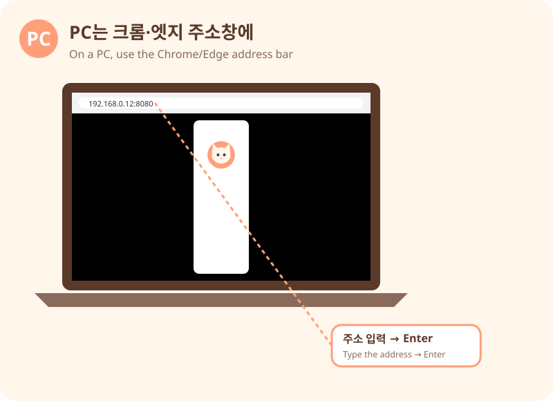

PC의 **크롬**이나 **엣지** 주소창에 폰에 뜬 주소를 입력하고 Enter를 누르면 됩니다.
화면을 두 번 클릭하거나 **전체 화면** 버튼을 누르면 꽉 차게 보입니다.

- TV와 PC에서 **동시에** 열어도 됩니다.

---

## 4부. 끝내기

다음 중 하나를 누르면 미러링이 멈춥니다. TV 화면에는 "연결이 끊겼어요"가 뜹니다.

- 미러냥 앱의 **미러링 멈추기** 버튼
- 알림 표시줄의 미러냥 알림 → **멈추기**

---

## 문제 해결

| 증상 | 해결 방법 |
|---|---|
| TV/PC에서 주소를 열어도 접속이 안 돼요 | ① 폰과 TV/PC가 **같은 Wi-Fi**인지 확인하세요. ② 게스트 네트워크나 회사·학교 Wi-Fi라면 기기끼리 통신이 막혀 있을 수 있습니다. ③ 공유기 설정의 **"AP 격리(AP Isolation)"**가 켜져 있으면 끄세요. ④ 주소의 숫자, 콜론(`:`), `8080`을 다시 확인하세요. |
| 주소가 안 떠요 / "Wi-Fi 주소를 찾지 못했어요" | 폰을 Wi-Fi에 연결한 뒤 멈추기 → 다시 시작하세요. |
| 연결은 됐는데 검은 화면이에요 | 주소 끝에 `/?mode=jpeg`를 붙이세요(호환 모드). 폰 화면이 꺼져 있지 않은지도 확인하세요. |
| 넷플릭스·디즈니+ 같은 앱만 검게 나와요 | 저작권 보호(DRM) 영상은 안드로이드가 캡처를 막습니다. 정상 동작이라 고칠 수 없어요. |
| 소리가 안 나와요 | 지금 버전은 화면만 보냅니다. 소리는 다음 버전에 넣을 예정이에요. |
| 끊기거나 느려요 | 폰과 TV를 공유기 가까이 두세요. 5GHz Wi-Fi가 더 좋습니다. |
| 폰을 가로로 돌리면 화면이 작아져요 | 지금 버전은 시작할 때의 방향으로 고정됩니다. 가로로 보려면 폰을 가로로 둔 상태에서 시작하세요. |
| 다른 사람이 볼 수 있나요? | 같은 Wi-Fi에 있으면서 주소를 아는 사람은 볼 수 있습니다. 공용 Wi-Fi에서는 쓰지 마세요. |

그래도 안 되면 [GitHub 이슈](https://github.com/yeomyaloo/mirror-nyang/issues)에 폰 기종, 안드로이드 버전, TV 모델, 증상을 적어 주세요.
