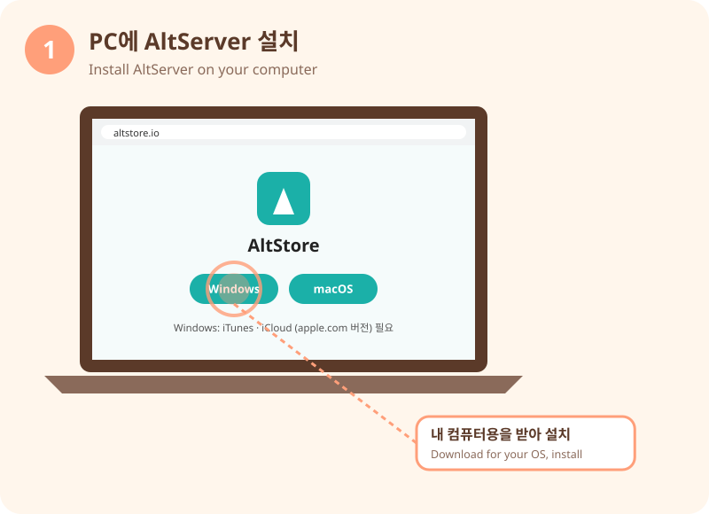
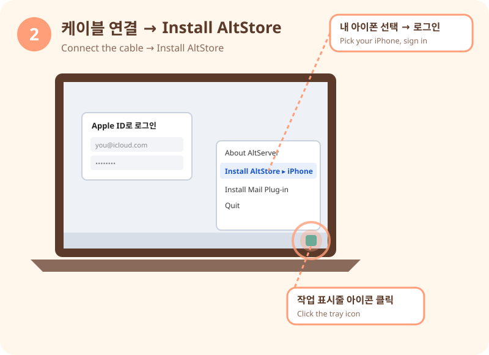
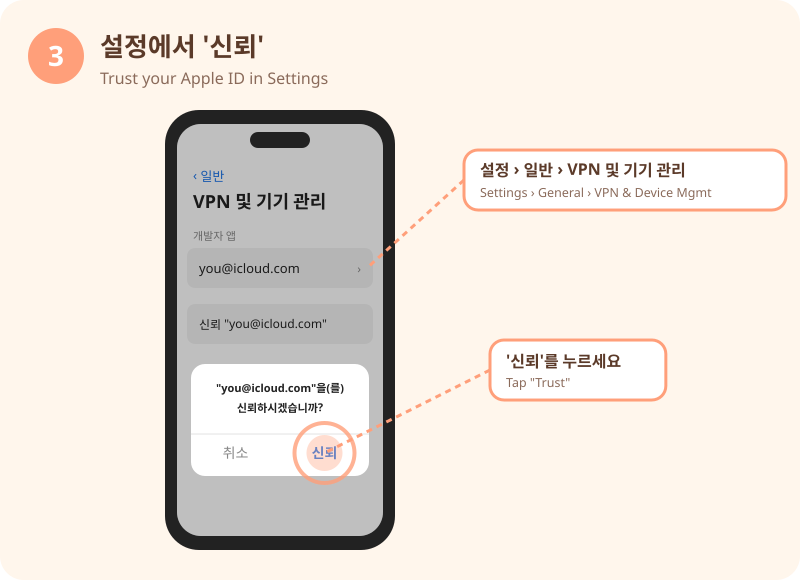
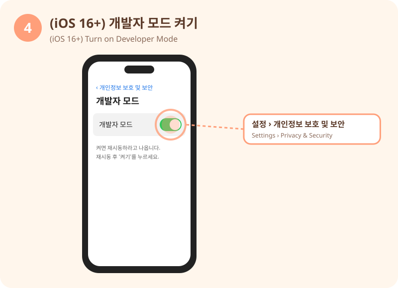
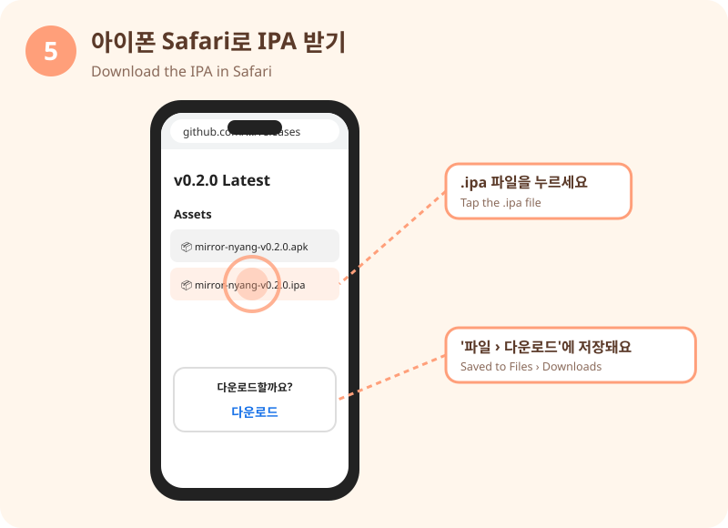
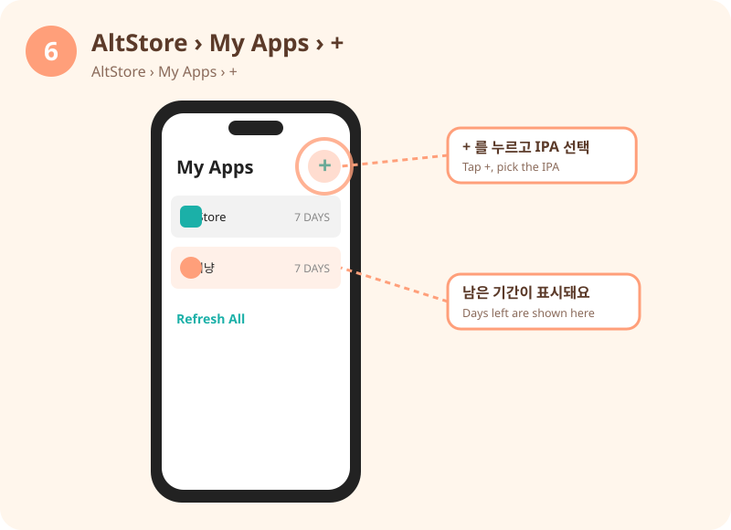
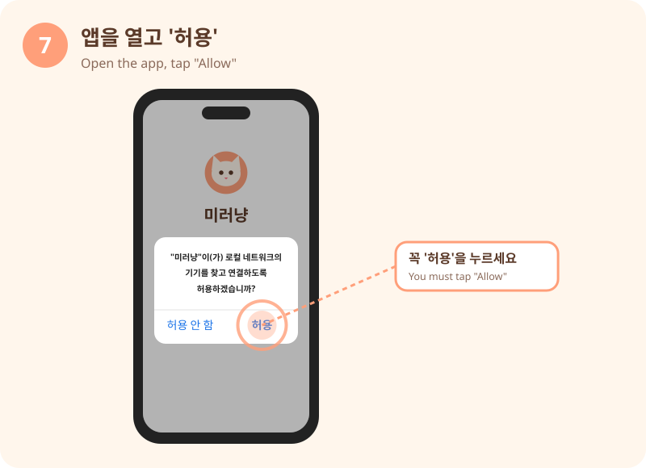
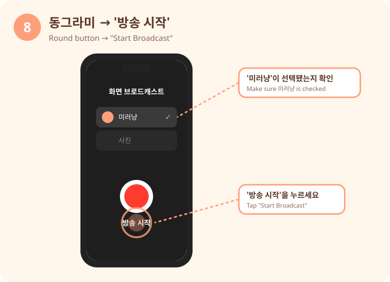
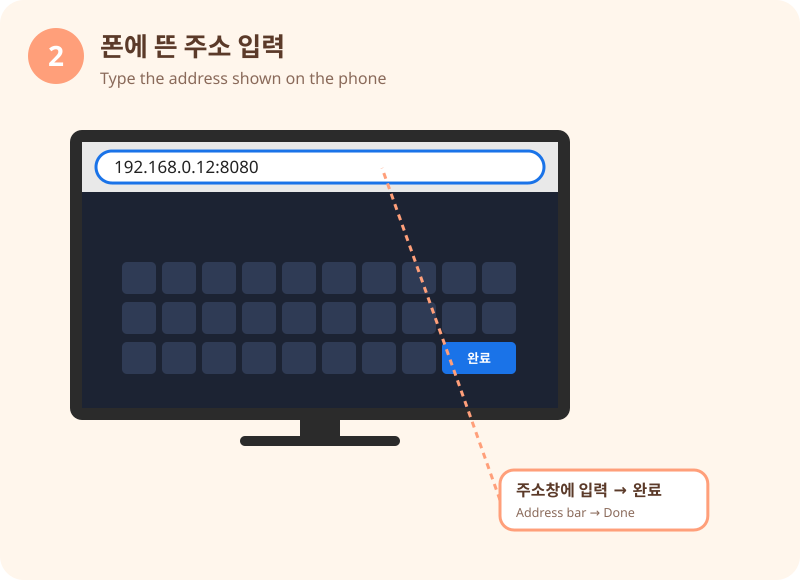
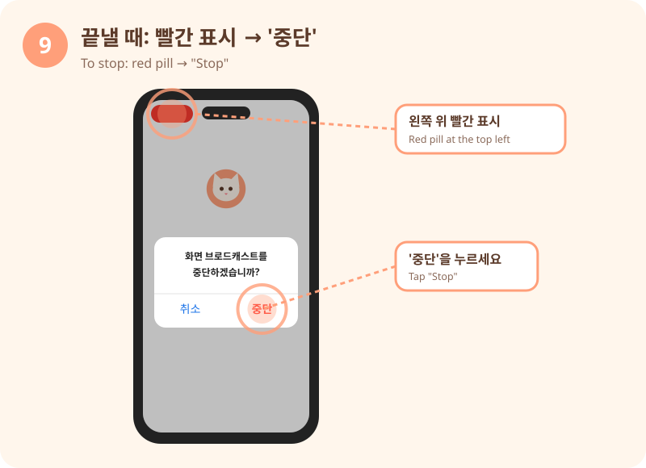

# 🍎 MirrorNyang iPhone Guide

[한국어](guide-iphone.ko.md) · [Back to README](../README.md) · [📱 Android guide](guide-android.en.md)

This guide shows, with pictures, how to show your iPhone screen on a **Samsung TV or a PC browser**.

> The app's screens are in Korean. Each step gives the Korean label you'll see, with its English meaning.

## Please read this first

Unlike Android, an iPhone **can't install an app straight from a download link.** Apple blocks it.
To install for free without the App Store, you **sign the app with your own Apple ID using a tool on your computer**, then install it.

| | |
|---|---|
| 💰 Cost | **Free.** Your normal Apple ID is enough. |
| 💻 You need | A **Windows PC or Mac** and a **USB cable** for the first install |
| ⏰ 7-day limit | Apps installed with a free Apple ID **stop opening after 7 days** unless you refresh them first. AltStore refreshes automatically (Part 3). Refreshing keeps your data. |
| 📱 3-app limit | A free Apple ID can have **only 3** apps installed this way at a time. AltStore itself counts as one. |
| ✅ Trust | After installing, you must **trust** your Apple ID once in Settings before the app opens. |
| 📶 Same Wi-Fi | While mirroring, the iPhone and the TV/PC must be on the same router. |

> Requires iOS 15 or later.
> Company "enterprise apps" can install from a link because the company signs them with a paid enterprise certificate. Personal apps can't use that.

## Contents

- [Part 1. Install (AltStore)](#part-1-install-altstore)
- [Alternative: install with Sideloadly](#alternative-install-with-sideloadly)
- [Part 2. Mirror](#part-2-mirror)
- [Part 3. Refresh every 7 days](#part-3-refresh-every-7-days)
- [Troubleshooting](#troubleshooting)

---

## Part 1. Install (AltStore)

AltStore is recommended because it handles the 7-day refresh **automatically**.

### Step 1. Install AltServer on your computer

1. On your computer, go to [altstore.io](https://altstore.io) and download AltServer for **Windows** or **macOS**. Install it.
2. **On Windows**, you also need these two. They must be the **versions from Apple's website**, not the Microsoft Store versions.
   - [iTunes (apple.com)](https://www.apple.com/itunes/)
   - iCloud for Windows (search "iCloud for Windows" on apple.com)
3. **On a Mac**, move AltServer to the Applications folder and open it. A ◆ icon appears in the menu bar.

### Step 2. Connect the cable → Install AltStore

1. **Connect the iPhone to the computer with a cable** and unlock it.
2. If the iPhone asks **"Trust This Computer?"**, tap **Trust** and enter your passcode.
3. Click the AltServer icon.
   - Windows: bottom right of the taskbar (click **^** to show hidden icons)
   - Mac: the menu bar at the top
4. Choose **Install AltStore → your iPhone's name**.
5. Enter your **Apple ID and password**.

- Your Apple ID is sent only to Apple's servers and is used only to sign the app.
- After a moment, the **AltStore** app appears on your iPhone.

### Step 3. Trust your Apple ID in Settings

The first time you open AltStore, it won't open and says **"Untrusted Developer"**. That's expected.

1. Open **Settings → General → VPN & Device Management**.
2. Under **Developer App**, tap **your Apple ID**.
3. Tap **Trust "(your Apple ID)"** → **Trust** (신뢰).

- You only do this once. MirrorNyang, installed with the same Apple ID, is trusted too.

### Step 4. (iOS 16+) Turn on Developer Mode

On iOS 16 and later, **Developer Mode** must be on for sideloaded apps to open.

1. Open **Settings → Privacy & Security**, scroll to the bottom, and tap **Developer Mode**.
2. Turn it on. It asks you to restart. Tap **Restart**.
3. After restarting, tap **Turn On** in the prompt and enter your passcode.

- If you can't see "Developer Mode", do Step 2 (install AltStore) first. The menu appears once a sideloaded app is installed.

### Step 5. Download the IPA in Safari on the iPhone

1. In **Safari on the iPhone**, open the [Releases page](https://github.com/yeomyaloo/mirror-nyang/releases/latest).
2. Under **Assets**, tap the file **ending in `.ipa`** (for example `mirror-nyang-v0.2.0.ipa`).
3. Tap **Download**. The file is saved to **Files → Downloads**.

- Don't tap the `.apk`. That's for Android.

### Step 6. AltStore › My Apps › +

1. Open **AltStore** and go to the **My Apps** tab at the bottom.
2. Tap **+** at the top left and pick the IPA from Step 5.
3. With AltServer running on your computer and the same Wi-Fi (or the cable connected), it installs. The first time, it may ask for your Apple ID again.
4. When 🐱 **미러냥** appears on your home screen, you're done. My Apps shows **7 DAYS** (time left).

- If you get an app-limit message, you've hit the free Apple ID's 3-app limit. Remove an app you don't use in My Apps.

---

## Alternative: install with Sideloadly

If AltStore is too much hassle, try **Sideloadly**. It's simpler to install, but it **doesn't refresh automatically**, so you must reconnect and reinstall every 7 days.

1. Install Sideloadly from [sideloadly.io](https://sideloadly.io). On Windows you need iTunes and iCloud (apple.com versions), as in Step 1.
2. Connect the iPhone with a cable and drag the `.ipa` file into the Sideloadly window.
3. Enter your **Apple ID** and click **Start**. Enter your password and verification code if asked.
4. Do [Step 3 (Trust)](#step-3-trust-your-apple-id-in-settings) and [Step 4 (Developer Mode)](#step-4-ios-16-turn-on-developer-mode).
5. **Every 7 days**, repeat steps 2–3 to keep using it.

---

## Part 2. Mirror

### Step 7. Open the app and tap "Allow"

The first time you open MirrorNyang, it asks for **Local Network** access. **You must tap "Allow"** (허용).
Without it, the TV/PC can't connect to the iPhone.

- If you tapped "Don't Allow" by mistake: turn on **Settings → 미러냥 → Local Network**.

### Step 8. Round button → "Start Broadcast"

1. Tap the **peach-colored round button** in the MirrorNyang app.
2. In the **Screen Broadcast** sheet, check that **미러냥** has a ✓.
3. Tap **Start Broadcast** (방송 시작). It starts after a 3-second countdown.

- You can also start from **Control Center**: swipe down from the top right, **long-press** the **Screen Recording (⏺)** button → **미러냥** → **Start Broadcast**.
- If there's no Screen Recording button, add it in **Settings → Control Center**.
- Once it starts, the clock at the top left turns **red**.

### Step 9. Type the address on the TV or PC

Type the address shown in the app, such as **`http://192.168.0.12:8080`**, into the TV or PC browser.
Opening it on the TV works the same as on Android. See [Part 3 of the Android guide](guide-android.en.md#part-3-watch-on-the-tv-or-pc) for pictures.

- Samsung TV: Home on the remote → **Internet** app → type it in the address bar
- PC: type it into the Chrome or Edge address bar
- If nothing shows, add `/?mode=jpeg` to the end of the address.

### Step 10. To stop: red pill → "Stop"

Tap the **red pill** at the top left, then tap **Stop** (중단). You can also tap the Screen Recording button in Control Center.

---

## Part 3. Refresh every 7 days

Apps installed with a free Apple ID **stop opening after 7 days.** Refreshing before then adds another 7 days.

**AltStore auto-refresh**
- Keep **AltServer running** on your computer. When the iPhone and computer are on the **same Wi-Fi**, AltStore refreshes in the background.
- The computer must be **on at least once within the 7 days**.
- On Windows, turning on "Sync with this iPhone over Wi-Fi" in iTunes helps it work without a cable.

**Refresh manually**
- With AltServer running, tap **AltStore → My Apps → Refresh All**.
- If 7 days have already passed and MirrorNyang won't open, that's fine. Refresh as above and it opens again, with your data intact.

---

## Troubleshooting

| Problem | What to do |
|---|---|
| It won't open: "Untrusted Developer" | Trust your Apple ID in Settings, as in [Step 3](#step-3-trust-your-apple-id-in-settings). |
| "App is no longer available" | The 7 days have passed. Refresh as in [Part 3](#part-3-refresh-every-7-days). On iOS 16+, also check Developer Mode is on. |
| AltServer can't find the iPhone | Check the cable, unlock the iPhone, and accept "Trust This Computer". On Windows, make sure iTunes and iCloud are the **apple.com versions**. |
| The TV/PC can't connect | ① Check **Local Network** access is on (Settings → 미러냥). ② Check both are on the same Wi-Fi. ③ Check the broadcast really started (red pill). |
| The broadcast stops by itself | iOS gives broadcast extensions very little memory (about 50 MB). Start again. If it keeps happening, open the page in compatibility mode (`/?mode=jpeg`). |
| Netflix and similar apps show black | iOS blocks capturing copy-protected video. This is expected. |
| There's no sound | This version sends the picture only. |

Still stuck? Open a [GitHub issue](https://github.com/yeomyaloo/mirror-nyang/issues) with your iPhone model, iOS version, install method (AltStore/Sideloadly), and what happens.
