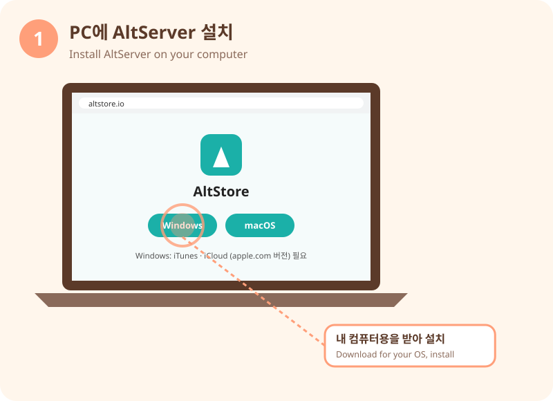
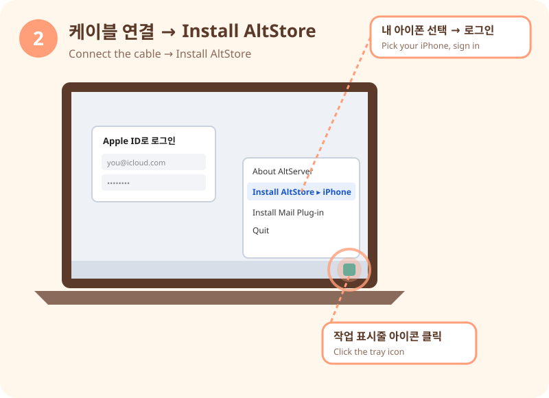
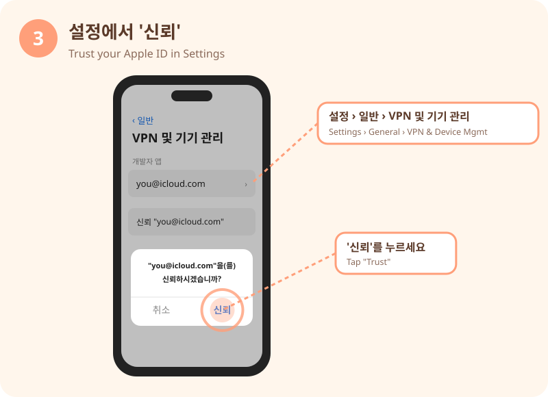
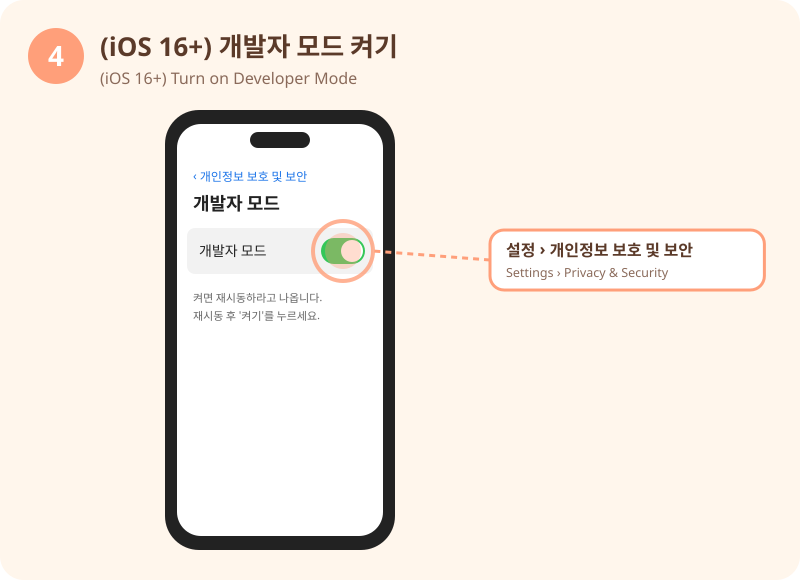
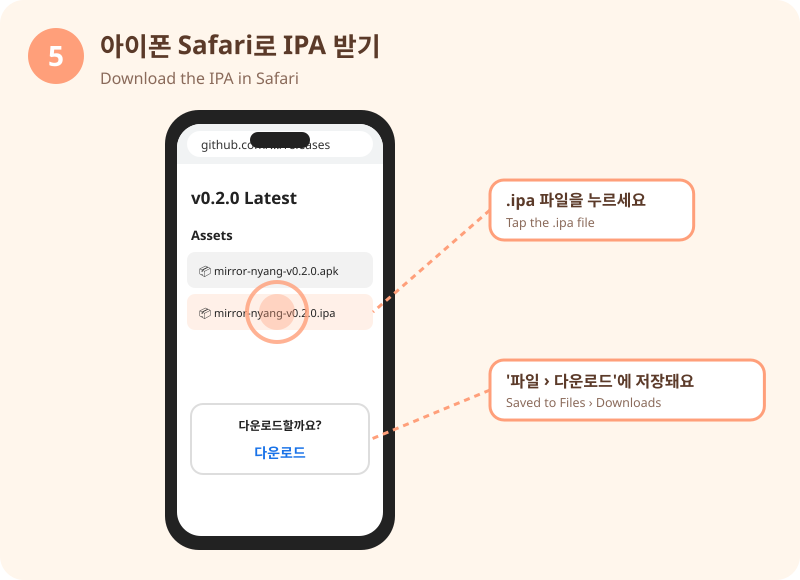
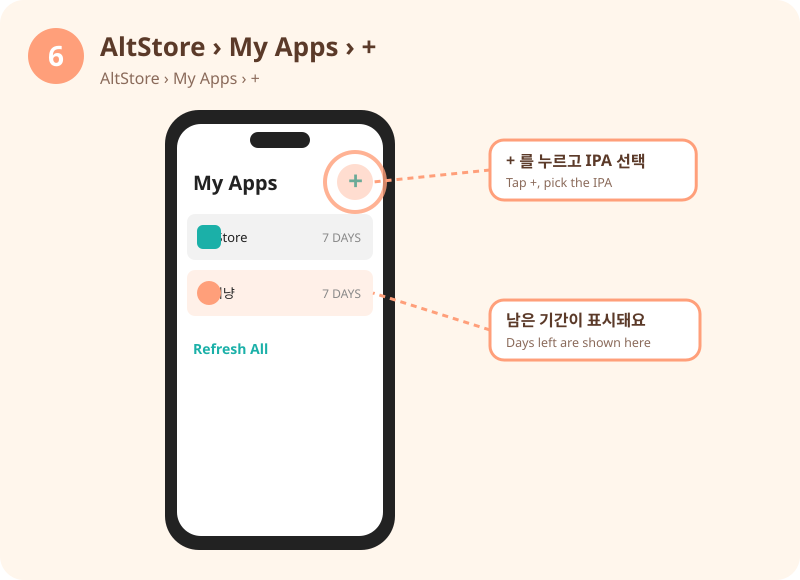
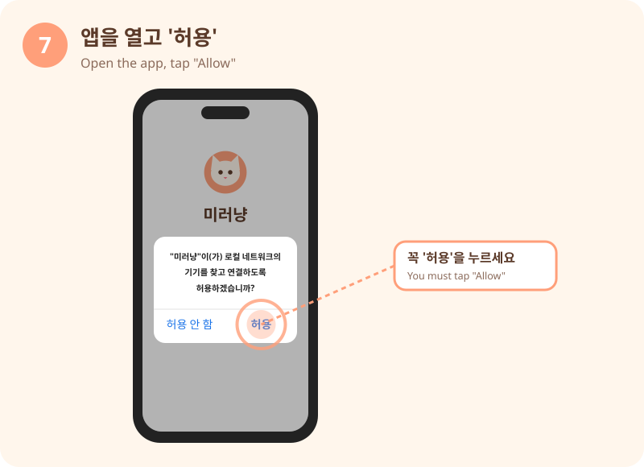
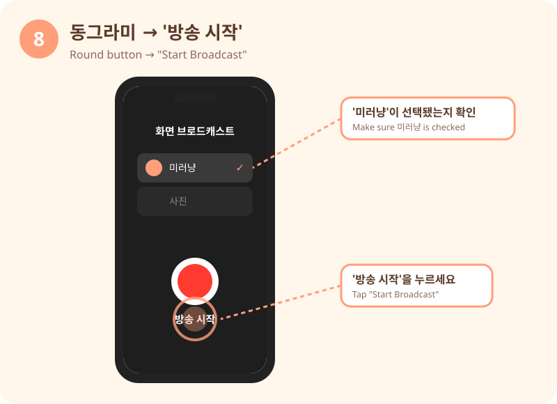
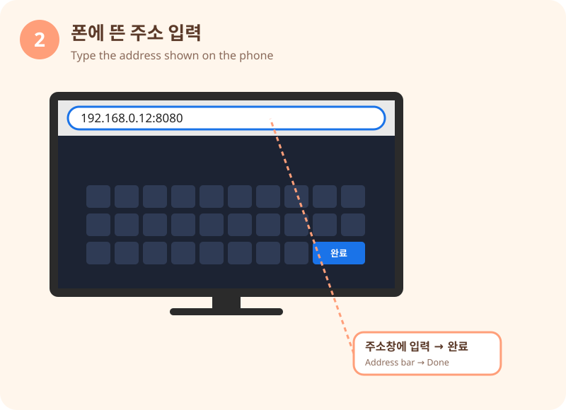
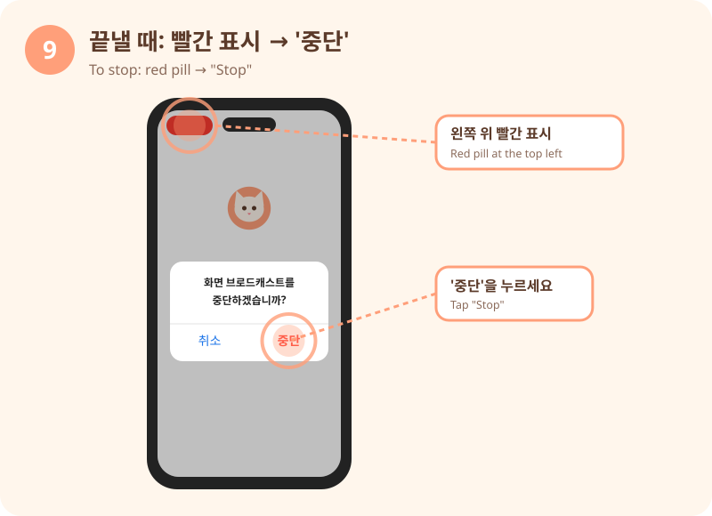

# 🍎 미러냥 아이폰 설명서

[English](guide-iphone.en.md) · [README로 돌아가기](../README.md) · [📱 안드로이드 설명서](guide-android.ko.md)

아이폰 화면을 **삼성 TV나 PC 브라우저**에 띄우는 방법을 그림으로 설명합니다.

## 시작하기 전에 꼭 읽어 주세요

아이폰은 안드로이드처럼 **링크를 눌러 앱을 바로 설치할 수 없습니다.** Apple이 막아두었기 때문이에요.
App Store 없이 무료로 설치하려면, **컴퓨터의 도구로 내 Apple ID를 써서 앱에 서명한 뒤** 설치해야 합니다.

| | |
|---|---|
| 💰 비용 | **무료**입니다. 평소 쓰는 Apple ID면 됩니다. |
| 💻 필요한 것 | **Windows PC나 Mac**, 처음 설치할 때 쓸 **USB 케이블** |
| ⏰ 7일 제한 | 무료 Apple ID로 설치한 앱은 **7일이 지나면 열리지 않습니다.** 그 전에 "갱신"해야 합니다. AltStore를 쓰면 자동으로 갱신됩니다(3부). 갱신해도 데이터는 지워지지 않습니다. |
| 📱 3개 제한 | 무료 Apple ID로는 이렇게 설치한 앱을 **동시에 3개까지만** 쓸 수 있습니다. AltStore도 1개로 칩니다. |
| ✅ 개발자 신뢰 | 설치한 뒤 설정에서 내 Apple ID를 한 번 **"신뢰"**해야 앱이 열립니다. |
| 📶 같은 Wi-Fi | 미러링할 때 아이폰과 TV/PC가 같은 공유기에 연결되어 있어야 합니다. |

> 아이폰은 iOS 15 이상이어야 합니다.
> 회사에서 쓰던 "기업용 앱"은 링크로 바로 설치됐을 수 있는데, 그건 회사가 유료 기업 인증서로 서명했기 때문입니다. 개인 앱은 그 방식을 쓸 수 없어요.

## 목차

- [1부. 설치하기 (AltStore)](#1부-설치하기-altstore)
- [다른 방법: Sideloadly로 설치하기](#다른-방법-sideloadly로-설치하기)
- [2부. 미러링하기](#2부-미러링하기)
- [3부. 7일마다 갱신하기](#3부-7일마다-갱신하기)
- [문제 해결](#문제-해결)

---

## 1부. 설치하기 (AltStore)

AltStore는 7일마다 하는 갱신을 **자동으로** 해주는 무료 도구라서 추천합니다.

### 1단계. 컴퓨터에 AltServer 설치

1. 컴퓨터에서 [altstore.io](https://altstore.io)에 들어가 내 컴퓨터용(**Windows** 또는 **macOS**) AltServer를 받아 설치합니다.
2. **Windows라면** 아래 두 개도 설치해야 합니다. 꼭 **Apple 홈페이지 버전**이어야 하고, Microsoft Store 버전으로는 안 됩니다.
   - [iTunes (apple.com)](https://www.apple.com/itunes/)
   - iCloud for Windows (apple.com에서 "Windows용 iCloud" 검색)
3. **Mac이라면** AltServer를 "응용 프로그램" 폴더로 옮기고 실행합니다. 메뉴 막대에 ◆ 아이콘이 생깁니다.

### 2단계. 케이블 연결 → Install AltStore

1. 아이폰을 **케이블로 컴퓨터에 연결**하고 잠금을 풉니다.
2. 아이폰에 **"이 컴퓨터를 신뢰하겠습니까?"**가 뜨면 **신뢰**를 누르고 암호를 입력합니다.
3. AltServer 아이콘을 누릅니다.
   - Windows: 작업 표시줄 오른쪽 아래(안 보이면 **^** 눌러 숨겨진 아이콘 열기)
   - Mac: 위쪽 메뉴 막대
4. **Install AltStore → 내 아이폰 이름**을 고릅니다.
5. **Apple ID와 암호**를 입력합니다.

- 입력한 Apple ID는 Apple 서버로만 전송되고, 앱에 서명하는 데만 쓰입니다.
- 잠시 뒤 아이폰 홈 화면에 **AltStore** 앱이 생깁니다.

### 3단계. 설정에서 "신뢰"

AltStore를 처음 열면 **"신뢰하지 않는 개발자"**라며 열리지 않습니다. 정상이에요.

1. 아이폰 **설정 → 일반 → VPN 및 기기 관리**로 갑니다.
2. **개발자 앱** 아래의 **내 Apple ID**를 누릅니다.
3. **"(내 Apple ID)" 신뢰** → **신뢰**를 누릅니다.

- 이 신뢰는 한 번만 하면 됩니다. 같은 Apple ID로 설치한 미러냥도 함께 신뢰됩니다.

### 4단계. (iOS 16 이상) 개발자 모드 켜기

iOS 16 이상에서는 **개발자 모드**를 켜야 직접 설치한 앱이 열립니다.

1. **설정 → 개인정보 보호 및 보안**을 맨 아래까지 내려 **개발자 모드**를 누릅니다.
2. 스위치를 켜면 재시동하라고 나옵니다. **재시동**을 누릅니다.
3. 재시동 후 뜨는 창에서 **켜기**를 누르고 암호를 입력합니다.

- "개발자 모드" 메뉴가 안 보이면 2단계(AltStore 설치)를 먼저 하세요. 직접 설치한 앱이 생겨야 메뉴가 나타납니다.

### 5단계. 아이폰 Safari로 IPA 받기

1. **아이폰 Safari**에서 [Releases 페이지](https://github.com/yeomyaloo/mirror-nyang/releases/latest)를 엽니다.
2. **Assets**에서 **`.ipa`로 끝나는 파일**(예: `mirror-nyang-v0.2.0.ipa`)을 누릅니다.
3. "다운로드할까요?"에서 **다운로드**를 누릅니다. 파일은 **파일 앱 → 다운로드**에 저장됩니다.

- `.apk`는 안드로이드용이라 누르지 마세요.

### 6단계. AltStore › My Apps › +

1. **AltStore**를 열고 아래쪽 **My Apps** 탭으로 갑니다.
2. 왼쪽 위 **+**를 누르고, 5단계에서 받은 IPA를 고릅니다.
3. 컴퓨터의 AltServer가 켜져 있고 같은 Wi-Fi(또는 케이블 연결)면 설치가 진행됩니다. 처음에는 Apple ID를 다시 물어볼 수 있습니다.
4. 홈 화면에 🐱 **미러냥**이 생기면 설치 끝입니다. My Apps에 **7 DAYS**(남은 기간)가 표시됩니다.

- "앱 개수 제한" 메시지가 나오면 무료 Apple ID의 3개 제한에 걸린 것입니다. My Apps에서 안 쓰는 앱을 지우세요.

---

## 다른 방법: Sideloadly로 설치하기

AltStore 설정이 어렵다면 **Sideloadly**도 있습니다. 설치는 더 간단하지만 **자동 갱신이 없어서** 7일마다 컴퓨터에 연결해 다시 설치해야 합니다.

1. 컴퓨터에 [sideloadly.io](https://sideloadly.io)에서 Sideloadly를 설치합니다. Windows는 위 1단계처럼 iTunes와 iCloud(apple.com 버전)가 필요합니다.
2. 아이폰을 케이블로 연결하고, `.ipa` 파일을 Sideloadly 창에 끌어다 놓습니다.
3. **Apple ID**를 입력하고 **Start**를 누릅니다. 암호와 인증 코드를 물어보면 입력합니다.
4. 위 [3단계(신뢰)](#3단계-설정에서-신뢰)와 [4단계(개발자 모드)](#4단계-ios-16-이상-개발자-모드-켜기)를 합니다.
5. **7일마다** 2~3번을 다시 하면 계속 쓸 수 있습니다.

---

## 2부. 미러링하기

### 7단계. 앱을 열고 "허용"

처음 미러냥을 열면 **로컬 네트워크** 권한을 물어봅니다. **꼭 "허용"**을 누르세요.
허용하지 않으면 TV/PC가 아이폰에 접속할 수 없습니다.

- 실수로 "허용 안 함"을 눌렀다면: **설정 → 미러냥 → 로컬 네트워크**를 켜세요.

### 8단계. 동그라미 → "방송 시작"

1. 미러냥 앱의 **복숭아색 동그라미** 버튼을 누릅니다.
2. **화면 브로드캐스트** 창에서 **미러냥**에 ✓가 있는지 확인합니다.
3. **방송 시작**을 누르면 3초 뒤 시작됩니다.

- **제어 센터**에서도 시작할 수 있습니다: 화면 오른쪽 위에서 쓸어내린 뒤 **화면 기록(⏺)** 버튼을 **길게** 누르고 → **미러냥** → **방송 시작**.
- 화면 기록 버튼이 없다면 **설정 → 제어 센터**에서 "화면 기록"을 추가하세요.
- 시작되면 왼쪽 위 시계가 **빨간색**으로 바뀝니다.

### 9단계. TV·PC에 주소 입력

미러냥 앱에 보이는 **`http://192.168.0.12:8080`** 같은 주소를 TV나 PC 브라우저에 입력합니다.
TV에서 여는 방법은 안드로이드와 똑같습니다. 그림과 함께 보려면 [안드로이드 설명서 3부](guide-android.ko.md#3부-tvpc에서-보기)를 보세요.

- 삼성 TV: 리모컨 홈 → **인터넷** 앱 → 주소창에 입력
- PC: 크롬이나 엣지 주소창에 입력
- 화면이 안 나오면 주소 끝에 `/?mode=jpeg`를 붙여 보세요.

### 10단계. 끝낼 때: 빨간 표시 → "중단"

왼쪽 위 **빨간 표시**를 누르고 **중단**을 누릅니다. 제어 센터의 화면 기록 버튼을 눌러도 멈춥니다.

---

## 3부. 7일마다 갱신하기

무료 Apple ID로 설치한 앱은 **7일 뒤 열리지 않습니다.** 그 전에 갱신하면 다시 7일이 늘어납니다.

**AltStore 자동 갱신**
- 컴퓨터에서 **AltServer를 켜두고**, 아이폰과 컴퓨터가 **같은 Wi-Fi**에 있으면 AltStore가 백그라운드에서 알아서 갱신합니다.
- 7일 안에 **한 번은 컴퓨터가 켜져 있어야** 합니다.
- Windows는 iTunes에서 "Wi-Fi로 이 iPhone과 동기화"를 켜두면 케이블 없이도 잘 됩니다.

**직접 갱신하기**
- AltServer가 켜진 상태에서 **AltStore → My Apps → Refresh All**을 누르세요.
- 이미 7일이 지나서 미러냥이 안 열려도 괜찮습니다. 위 방법으로 갱신하면 다시 열립니다. 데이터는 그대로입니다.

---

## 문제 해결

| 증상 | 해결 방법 |
|---|---|
| "신뢰하지 않는 개발자"라며 안 열려요 | [3단계](#3단계-설정에서-신뢰)처럼 설정에서 신뢰하세요. |
| "앱을 사용할 수 없음"이 떠요 | 7일이 지났습니다. [3부](#3부-7일마다-갱신하기)처럼 갱신하세요. iOS 16+라면 개발자 모드가 켜져 있는지도 확인하세요. |
| AltServer가 아이폰을 못 찾아요 | 케이블 연결, 아이폰 잠금 해제, "이 컴퓨터 신뢰"를 확인하세요. Windows는 iTunes·iCloud가 **apple.com 버전**인지 확인하세요. |
| TV/PC에서 접속이 안 돼요 | ① **로컬 네트워크** 권한이 켜져 있는지(설정 → 미러냥) 확인하세요. ② 같은 Wi-Fi인지 확인하세요. ③ 방송이 실제로 시작됐는지(빨간 표시) 확인하세요. |
| 방송이 금방 저절로 끝나요 | iOS는 방송 기능에 메모리를 아주 적게(약 50MB) 줍니다. 다시 시작해 보고, 계속 그러면 호환 모드(`/?mode=jpeg`)로 열어 보세요. |
| 넷플릭스 같은 앱이 검게 나와요 | 저작권 보호 영상은 iOS가 캡처를 막습니다. 정상 동작이에요. |
| 소리가 안 나와요 | 지금 버전은 화면만 보냅니다. |

그래도 안 되면 [GitHub 이슈](https://github.com/yeomyaloo/mirror-nyang/issues)에 아이폰 기종, iOS 버전, 설치 방법(AltStore/Sideloadly), 증상을 적어 주세요.
